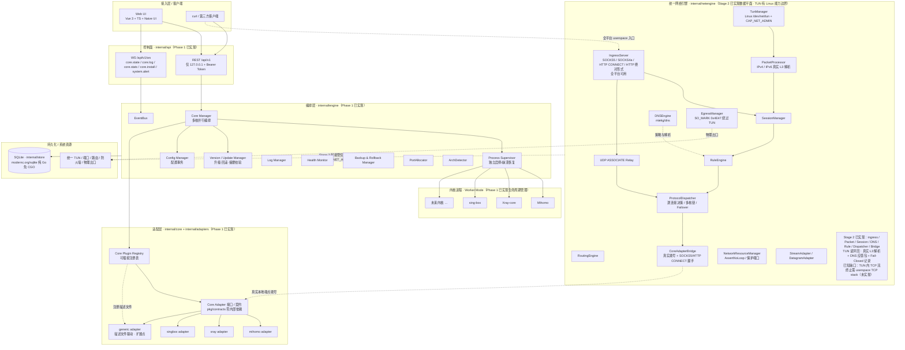
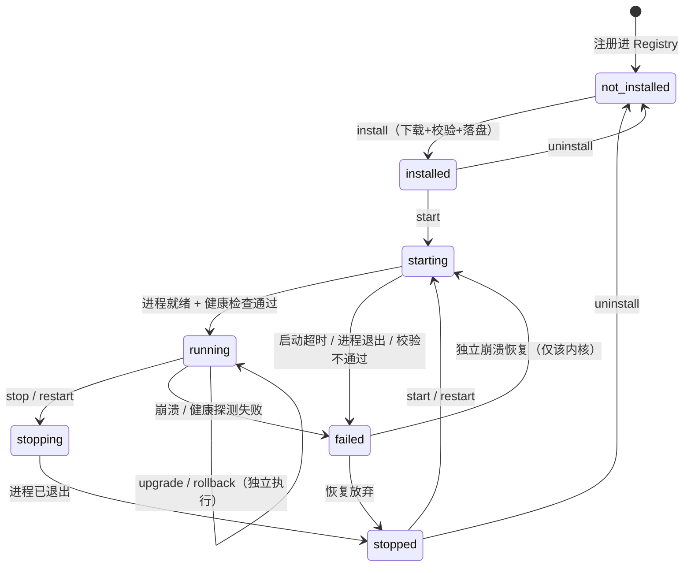
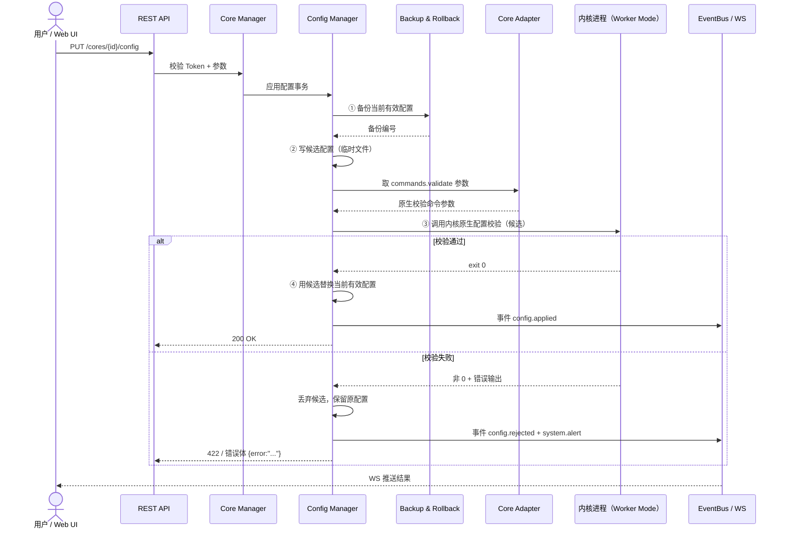
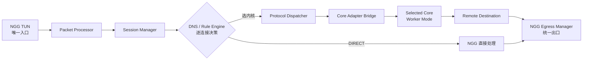

# NGG 技术设计文档

> **项目**：NGG — Next-Generation Gateway（次世代网关）
> **适用版本**：Phase 1 + Stage 2~5 当前实现（本文主体为 Phase 1 基线，Stage 2~5 更新见 **§12A**）
> **文档状态**：架构设计 + Phase 1 实现边界说明 + Stage 2~5 实现状态补充
> **模块名**：`github.com/ngg-project/ngg`（`go.mod` 声明 `go 1.26.0`）

---

## 0. 范围声明与阅读须知

本文描述 NGG 的**完整架构目标**（覆盖 Stage 1 ~ Stage 5），但必须严格区分三类内容：

| 标记 | 含义 |
| --- | --- |
| **【已实现】** | Phase 1 / Stage 1 已经落地、可运行、经真实环境验证的能力 |
| **【接口预留】** | 仅定义接口 / 类型 / 常量，**零可执行逻辑**，后续阶段实现 |
| **【规划 / 禁止】** | 后续阶段目标，或 Phase 1 明确**禁止**提前实现的内容 |

> **重要**：统一 TUN、Packet Processor、Session Manager、Protocol Dispatcher、Core Adapter Bridge 等统一网络引擎组件，在 Phase 1 **仅存在于 `internal/netengine/` 的接口占位**（常量 `Stage2NotImplemented`），**不得被理解为已实现功能**。本文第 3、10 节描述的是**目标架构与流量路径设计**，其可执行实现属于 Stage 2 及以后。
>
> **测试纪律**：所有模块必须在**真实网络环境**中验证，禁止以模拟 / mock 的"成功状态"充当验收结果（详见 `06-roadmap.md`）。
>
> **版本更新说明**：本文主体描述 Phase 1 基线；Stage 2~5 交付后的当前实现状态见 **§12A**，第 3 节分层架构图与第 11 节路线图概要已按当前实现更新。**10 条最高级约束与全部 ADR 保持不变。**

### 0.1 术语表

| 术语 | 说明 |
| --- | --- |
| **NGG** | 本网关进程（`nggd`），唯一系统网络入口与统一控制中心 |
| **Core（内核）** | 协议执行引擎，如 Mihomo / Xray-core / sing-box 及未来新增内核 |
| **Core Adapter** | 内核适配层，把某个内核的能力标准化为统一契约 |
| **Core Plugin Registry** | 可插拔内核注册表，管理所有已注册内核及其能力描述 |
| **Worker Mode** | 内核以「 Worker / 纯协议执行」模式运行，不接管系统流量 |
| **Single Unified TUN** | 由 NGG 唯一创建、唯一管理的虚拟网络接口 |
| **DIRECT** | 不经过任何内核、由 NGG 直接转发的连接路径 |
| **配置事务** | 一次配置变更的原子流程：备份 → 写候选 → 原生校验 → 通过才替换 |

---

## 1. 架构定位

NGG 的定位是：

> **Single Unified TUN + Unified Network Engine + Multi-Core Protocol Runtime**
> **单一统一 TUN + 统一网络引擎 + 多内核协议运行时**

一句话概括：**NGG 是唯一的系统网络入口、统一流量控制中心、统一出口调度中心；Mihomo / Xray-core / sing-box 以及未来所有内核，都只是可插拔的「协议执行引擎」，而不是流量接管者。**

- 流量**接管、识别、决策、调度、出口**全部归 NGG；
- 内核只负责**按 NGG 的指令完成协议编解码与远程传输**；
- 内核之间**彼此不知道对方存在**，由 NGG 统一编排。

这与"每个内核各自创建 TUN、各自抢路由、各自劫持 DNS"的传统多开方案有本质区别，也是本设计最高优先级的约束来源。

---

## 2. 最高级架构约束

以下 10 条是用户明确要求、用于**替换旧设计**的最高优先级约束，优先级高于任何早期初始化指令中的措辞，所有设计与实现不得违背。

### 约束 1 — 角色定位
NGG 是**唯一系统网络入口、统一流量控制中心、统一出口调度中心**；Mihomo / Xray-core / sing-box 及未来内核都是**可插拔的「协议执行引擎」**，**不是流量接管者**。

### 约束 2 — 统一 TUN 与 Worker Mode
**统一 TUN 由 NGG 创建与管理**；三个内核一律以 **Worker Mode** 运行：
- 禁止各自创建系统级默认 TUN；
- 禁止抢占全局路由；
- 内核自带 DNS 劫持**默认关闭**。

### 约束 3 — NGG 独立拥有的网络能力
NGG **独立拥有**以下组件，全局规则 / DNS / 路由策略**不得分散给内核**：
`TUN Manager`、`Packet Processor`、`Session Manager`、`Rule Engine`、`DNS Engine`、`Routing Engine`、`Protocol Dispatcher`、`Core Adapter Bridge`、`Egress Manager`、`Network Resource Manager`。

### 约束 4 — 多核并行（含覆盖关系声明）
- 任意**多个**已注册内核可**同时启动 / 运行**；
- 用户**自主选择**运行哪些内核；
- 每个内核可**独立停止 / 重启 / 升级 / 回滚 / 故障恢复**；
- **一个内核故障不得自动停止其他健康内核**。

> **⚠ 覆盖关系（必须明确）**：Phase 1 早期初始化指令中曾出现「**默认单主内核模式**」的措辞。**该措辞已被本条最高级约束明确覆盖并废止**——NGG **不存在**「单主内核 / 主内核」概念，也不存在「同一时刻仅允许一个内核运行」的限制。Phase 1 的 `Core Manager` 与 `Process Supervisor` 从设计上即支持多核并行注册、并行启动、独立生命周期。任何文档、代码、UI 若出现「单主内核」「主内核切换」「互斥运行」等表述，均视为与设计冲突，须按本条修正。详见 **ADR-001**。

### 约束 5 — 标准接入方式
每个内核通过**标准 Core Adapter** 注册协议能力；优先使用**本地 SOCKS5 / HTTP CONNECT / 透明代理及内核原生接口**；后续（Stage 2+）允许 **Native Stream / Datagram Adapter** 直接对接。

### 约束 6 — 统一流量路径
```
NGG TUN
  → Packet Processor
  → Session Manager
  → DNS / Rule Engine
  → Protocol Dispatcher
  → Core Adapter Bridge
  → Selected Core
  → Remote Destination
  → NGG Egress Manager
```
- **DIRECT** 由 NGG 直接处理，不经过任何内核；
- **每条连接**由 NGG **独立决定**执行路径（选哪个内核、或 DIRECT）。

> 该路径是**目标设计**（Stage 2 落地）；Phase 1 的 `internal/netengine/` 仅保留接口占位。

### 约束 7 — Core Plugin Registry
必须有 **Core Plugin Registry**；新内核通过**标准 Adapter + 能力描述文件**注册；**三个内置内核不得写死为唯一可用内核**；**新增内核不得要求重写 NGG Network Engine**。

### 约束 8 — 资源隔离
NGG **统一管理**：TUN、TCP/UDP 端口、DNS 监听、路由表、防火墙、网络接口、进程标识、出站路由标记；
必须**防回环、防端口冲突、防路由冲突**；**内核的远程传输连接必须能绕过 NGG TUN、走指定物理出口**。

### 约束 9 — 安全
`Fail-Closed`、`Failover`、内核**独立崩溃恢复**、TUN 异常检测、DNS 故障处理、连接状态恢复、**防 DIRECT 泄漏**、控制 API 权限隔离。

### 约束 10 — 开发顺序与工程纪律
五阶段顺序：`Stage1 统一管理中心 + 多核并行 + Core Adapter + Core Registry` → `Stage2 NGG TUN/会话/Packet Processor/Protocol Dispatcher/Core Bridge` → `Stage3 统一规则引擎/DNS/出入口策略` → `Stage4 传统 VPN/加密代理/新内核/后量子` → `Stage5 SD-WAN/企业网关/全平台`。
**接口提前预留，禁止提前堆积未经验证的实现；所有模块必须真实网络环境测试，禁止模拟成功状态。**

---

## 3. 分层架构



**分层阅读要点**

1. **Phase 1 的可运行边界在 L1 + L2 + L3 + L5 + L6**：REST/WS、编排引擎、适配器与注册表、内核进程生命周期、SQLite 持久化均已实现。
2. **L4（统一网络引擎）在 Phase 1 是接口占位**：`internal/netengine/` 中只有接口、类型与 `Stage2NotImplemented` 常量，**没有任何可执行逻辑**。图中 L4 → L5 的流量路径是**目标设计**，不是当前运行链路。
3. **Phase 1 内核如何被使用**：内核以 Worker Mode 由 `Process Supervisor` 独立拉起，NGG 通过本地 SOCKS5 / HTTP CONNECT / 原生接口使用其协议能力；`Config Manager` 负责配置事务，`Version/Update Manager` 负责升级回滚。NGG **尚未**接管系统 TUN / 全局流量。
4. **上层不执行 Shell**：Web UI 与 API 的所有操作都经 `Core Adapter + Core Manager`，UI 不执行 Shell、不直接操作内核进程。
5. **Stage 2~5 更新（当前版本）**：L4 的 `internal/netengine/` 已由「接口占位」变为**已实现的数据平面**（userspace 统一入口、Packet Processor、Session Manager、逐连接 Dispatcher、Core Bridge、Fail-Closed/Failover 决策）；Stage 3 规则/DNS、Stage 4 协议中心/后量子/插件、Stage 5 SD-WAN/多租户/跨平台共享核心亦已落地，对应 **40 个新增 REST 端点**（见 `09-stage2-5-api.md`）。**统一 TUN 有 Linux 能力边界**（`/dev/net/tun` + `CAP_NET_ADMIN`），Windows/macOS 返回 `ErrTUNUnsupported` 并改用全平台可用的 SOCKS5 / HTTP CONNECT 入口；**TUN 读环回目前完成真实 L3 解析、IPv4 DNS 应答包构造与 Fail-Closed 记录，TUN 内 TCP 流终止需要 userspace TCP stack，属于尚未实现的已知缺口**，不得写成「已实现统一 TUN 全局接管」。逐项状态、交付物与验收证据见 **§12A**、`07-stage2-network-engine.md`、`08-stage3-5-features.md`。

---

## 4. 模块清单与职责

| 模块 | 包路径 | 职责 | Phase 1 状态 |
| --- | --- | --- | --- |
| 服务入口 | `cmd/nggd/` | Go 服务启动、装配各 Manager、加载配置 | 【已实现】 |
| 共享契约 | `pkg/contracts/` | 共享 DTO 与能力描述契约，**零内部依赖** | 【已实现】 |
| Core Adapter 接口 | `internal/core/` | 定义 `CoreAdapter` 接口 | 【已实现】 |
| Core Plugin Registry | `internal/core/` | 可插拔内核注册表，注册 / 查询 / 重载能力描述 | 【已实现】 |
| 模块端口接口 | `internal/core/` | `Supervisor` / `ConfigManager` / `VersionManager` / `HealthMonitor` / `PortAllocator` / `StateStore` / `EventBus` / `LogSink` 端口定义 | 【已实现】 |
| 内置适配器 | `internal/adapters/mihomo`、`xray`、`singbox` | 纯函数式：生成版本参数、原生配置校验参数、运行参数、默认 Worker Mode 配置、Release 资产名 | 【已实现】 |
| 描述文件驱动适配器 | `internal/adapters/generic/` | 把能力描述 `yaml/json` 转成 `CoreAdapter`，**新增内核的扩展点** | 【已实现】 |
| Core Manager | `internal/engine/` | 多核并行编排、生命周期总控、故障隔离 | 【已实现】 |
| Process Supervisor | `internal/engine/` | 独立启停 / 重启 / 崩溃检测与恢复 | 【已实现】 |
| Version / Update Manager | `internal/engine/` | 真实版本读取、下载、来源/版本/SHA256 校验、升级、版本回滚 | 【已实现】 |
| Config Manager | `internal/engine/` | 配置导入 / 导出 / 备份、配置事务（备份→候选→原生校验→替换） | 【已实现】 |
| Log Manager | `internal/engine/` | 实时日志采集与查询 | 【已实现】 |
| Health Monitor | `internal/engine/` | CPU / 内存 / 进程状态监控 | 【已实现】 |
| Backup & Rollback Manager | `internal/engine/` | 配置与版本备份、回滚 | 【已实现】 |
| EventBus | `internal/engine/` | 事件发布订阅，驱动 WS 推送 | 【已实现】 |
| PortAllocator | `internal/engine/` | 端口分配与冲突检测 | 【已实现】 |
| ArchDetector | `internal/engine/` | 架构 / 平台识别，匹配 Release 资产名 | 【已实现】 |
| 状态持久化 | `internal/store/` | SQLite（`modernc.org/sqlite` 纯 Go，免 CGO），服务重启后状态恢复 | 【已实现】 |
| REST + WebSocket API | `internal/api/` | 仅监听 127.0.0.1，Bearer Token 认证 | 【已实现】 |
| 统一网络引擎（12 组件） | `internal/netengine/` | `TunManager` / `PacketProcessor` / `SessionManager` / `RuleEngine` / `DNSEngine` / `RoutingEngine` / `ProtocolDispatcher` / `CoreAdapterBridge` / `EgressManager` / `NetworkResourceManager` / `StreamAdapter` / `DatagramAdapter` | **【接口预留】** 零可执行逻辑，常量 `Stage2NotImplemented`，Stage 2 落地 |
| 管理界面 | `web/` | Vue 3 + TS + Naive UI | 【已实现】 |
| 配置 / 脚本 / 数据 / 产物 | `configs/`、`scripts/`、`data/`、`bin/` | 配置文件、构建脚本、运行数据、二进制产物 | 【已实现】 |

> **Stage 2~5 更新**：上表「统一网络引擎（12 组件）」一行的 **Phase 1 状态为【接口预留】**（历史基线，保留不改）。当前版本该行已变为 **【已实现（含 Linux TUN 能力边界）】**：`internal/netengine/` 现有真实数据平面实现，逐模块职责见 `07-stage2-network-engine.md` §2，状态总览见 **§12A**。

---

## 5. Core Adapter 契约

### 5.1 设计原则：纯函数化

`Core Adapter` 被刻意设计为**纯函数式**的"参数生成器 + 能力描述"，而不是"持有状态的执行器"：

- 适配器**不启动进程、不写文件、不发网络请求**；
- 它只根据输入，返回**该内核专属的参数**：
  - 版本读取命令参数；
  - **内核原生配置校验**命令参数；
  - 运行（Worker Mode）命令参数；
  - 默认 Worker Mode 配置；
  - Release 资产名（按平台 / 架构）。
- 真正的执行统一交给 `internal/engine/` 的 Manager（Supervisor / Version / Config）。

这样做的原因见 **ADR-002**：可测试、可组合、可被 `generic` 描述文件完全替代，且新增内核无需改动引擎。

### 5.2 契约分层

```
pkg/contracts/          共享 DTO 与能力描述（零内部依赖，任何层都可引用）
        │
        ▼
internal/core/          CoreAdapter 接口 + 模块端口接口 + Registry
        │
        ├── internal/adapters/{mihomo,xray,singbox}/   手写纯函数实现
        └── internal/adapters/generic/                 描述文件 → CoreAdapter
```

`CoreAdapter` 对外表达的是**"这个内核能做什么、怎么做"**，典型能力维度：

| 能力维度 | 说明 |
| --- | --- |
| 身份 | `id`、`display_name`、`repository` |
| 能力声明 | `capability`（支持的入站 / 出站协议、是否支持 SOCKS5 / HTTP CONNECT / 透明代理等） |
| 平台 | `platforms`（OS / 架构矩阵） |
| 二进制 | `binary` 名称 |
| 命令 | `commands.version` / `commands.run` / `commands.validate` |
| 配置 | `config.file_name` / `config.default` |
| 发布资产 | `release.repository` / `asset_template` / `digest_template` / `archive` |
| 版本解析 | `version_regex` |

> 字段名与完整示例见 `03-development.md`。所有操作必须经 `Core Adapter + Core Manager`，**UI 不执行 Shell，不改内核源码**。

---

## 6. Core Plugin Registry 扩展机制

### 6.1 为什么不写死三个内核

Mihomo / Xray-core / sing-box 只是**内置的三个已注册内核**，它们与 `generic` 描述文件注册的内核享有**同等地位**：

```
Registry
  ├── mihomo    ← 内置适配器（也可等价地用描述文件表达）
  ├── xray      ← 内置适配器
  ├── singbox   ← 内置适配器
  └── *.yaml    ← configs/cores.d/ 下的描述文件，由 generic adapter 装载
```

- 引擎只面向 `CoreAdapter` 接口编程，**不 import 任何具体内核包做分支判断**；
- 新增内核**不要求重写 NGG Network Engine**（约束 7）；
- `GET /registry`、`POST /registry/reload` 可查询与热重载注册表（见 `02-api.md`）。

### 6.2 用描述文件新增内核（概要）

1. 在 `configs/cores.d/` 新增一个 `.yaml`（或 `.json`）能力描述文件；
2. 填写 `id` / `display_name` / `repository` / `capability` / `platforms` / `binary` / `commands` / `config` / `release` / `version_regex`；
3. `generic` adapter 将其解析为 `CoreAdapter` 并注册进 Registry；
4. 调用 `POST /registry/reload`（或重启服务）生效；
5. 新内核即可像内置内核一样被 `install / start / stop / upgrade / rollback` 与独立监控。

完整字段说明与可直接复制的示例见 `03-development.md` 第 5 节。

### 6.3 内核独立原则

每个内核**独立安装、独立存储、独立运行**：
- 独立目录：`/var/lib/ngg/cores/<id>/`（见 `04-installation.md`）；
- 独立进程与端口（由 `PortAllocator` 分配）；
- 独立配置、独立备份、独立版本链；
- 一个内核故障**不自动停止其他健康内核**（约束 4）。

---

## 7. 内核生命周期状态机



**状态说明**

| 状态 | 含义 |
| --- | --- |
| `not_installed` | 已注册但本地无二进制 |
| `installed` | 二进制与版本摘要校验通过、已落盘 |
| `starting` | 正在拉起进程，等待就绪 |
| `running` | 进程存活且健康监控通过 |
| `stopping` / `stopped` | 正在停止 / 已停止 |
| `failed` | 启动失败或运行期崩溃 |
| `unknown` | 注册表查不到该 id 等异常情况下的兜底状态（`CoreState` 枚举含此项） |

**故障隔离（约束 4）**：`failed → starting` 的恢复动作**只作用于该内核**；`Process Supervisor` 不得因内核 A 故障而 stop 内核 B。`EventBus` 会推送 `core.state` 与 `system.alert`，但**不触发全局停机**。

---

## 8. 配置事务

### 8.1 强制顺序（不可调换）

任何配置变更必须严格按以下顺序执行：

```
① 备份当前有效配置  →  ② 写候选配置  →  ③ 调用内核原生配置校验  →  ④ 校验通过才替换
                                                              └→ 校验失败：保留原配置，丢弃候选
```

- **校验失败保留原配置**，绝不留下半写入状态；
- 校验使用**内核原生**能力（`commands.validate`），NGG 不自行解释内核配置语义；
- 每步结果写入 `audit` 审计记录；
- 备份可用于 `POST /cores/{id}/config/rollback` 回滚。

### 8.2 时序图



> 单独调用 `POST /cores/{id}/config/validate` 只执行 **②③**（不替换、不备份），供 UI 预校验使用。

---

## 9. 资源隔离与端口分配

### 9.1 NGG 统一管理的资源

`NetworkResourceManager`（**接口预留，Stage 2 落地**）的目标管辖范围；Phase 1 中 `PortAllocator` 已负责**端口冲突检测**这一子集：

| 资源 | 说明 | Phase 1 |
| --- | --- | --- |
| 统一 TUN | 唯一虚拟接口 | 【接口预留】 |
| TCP / UDP 端口 | 每个内核的本地入站端口 | 【已实现】分配 + 冲突检测 |
| DNS 监听 | 统一 DNS 监听地址 | 【接口预留】 |
| 路由表 / 防火墙 / 网络接口 | 全局网络资源 | 【接口预留】 |
| 进程标识 | 内核进程 PID / 工作目录隔离 | 【已实现】 |
| 出站路由标记 | 绕过 TUN 的物理出口标记 | 【接口预留】 |

> **Stage 2~5 更新**：上表是 **Phase 1 基线**（保留不改）。当前版本 `NetworkResourceManager` 已由 `internal/netengine/resources.go` 实现：集中预留 TUN / 端口 / 内核端口、`AssertNoLoop` 防回环、保护端口与 `169.254.0.0/16`、`10.89.0.0/24`、`fd89::/64` 保留网段；`EgressManager.Dialer()` 在 Linux 通过 `SO_MARK 0x4E47` 让内核远程传输绕过 NGG TUN（非 Linux 用绑定本地地址，能力缺失如实反映）。详见 `07-stage2-network-engine.md` §3 / §7。

### 9.2 端口分配策略（Phase 1）

- `PortAllocator` 为每个已注册内核分配**独立的 5 端口块**：`mixed` / `socks` / `http` / `api` / `dns`（`RuntimeParams`），由 `cores.port_base`（默认 `17890`）与 `cores.port_stride`（默认 `10`）计算；`RuntimeParams.Validate()` 会拒绝块内端口重复；
- 启动前 `startLocked` 会做**真实 TCP/UDP bind 探测**（`PortAllocator.Check`），发现占用即返回 `PORT_CONFLICT`，**不静默换端口报成功**；
- `GET /ports` 返回 `PortAllocation[]`（`core_id` / `ports[]` / `names{port:role}`）；`GET /ports/check?ports=...` 返回 `{"conflicts":[...]}` 供主动探测；
- 端口分配与进程期望状态持久化于 SQLite，服务重启后由 `Engine.New` 重新分配、`Engine.Restore` 恢复原运行内核（**单核恢复失败不影响其他内核**）；
- 每个内核的端口块与 `<storage.dir>/cores/<id>/` 目录均**互不重叠**（约束 8）。

### 9.3 防回环与远程传输绕行（设计目标）

> 以下为**约束 8 的目标设计**，由 Stage 2 的统一网络引擎落地，Phase 1 尚未接管系统流量：

- **防回环**：内核的远程传输连接必须能被识别并**绕过 NGG TUN**，否则会形成「内核出站 → 又进 TUN → 再回内核」的死循环；
- **指定物理出口**：通过出站路由标记把内核远程连接绑定到指定物理网卡 / 出口；
- **防路由冲突**：NGG 是唯一写全局路由者，内核不得写默认路由；
- **防 DIRECT 泄漏**（约束 9）：`Fail-Closed`——当规则 / DNS / 出口状态不确定时，**默认丢弃而非直连**，避免绕过策略造成泄漏。
- **Stage 2~5 落地情况**：上述防回环 / 指定物理出口 / Fail-Closed 已在 `AssertNoLoop`、`SO_MARK`、`protocolDispatcher.OpenWithDecision` 中实现，并由 `TestSessionManagerAndResources`、`TestFailClosedWhenKernelDown` 真实验证；**统一 TUN 全局接管（全平台）仍未实现**，见 §12A 与 `07-stage2-network-engine.md` §3.3。

---

## 10. 统一流量路径（Stage 2 已实现数据平面 · TUN 有 Linux 能力边界）

> **Phase 1 基线**：本节原为**架构目标**，当时 `internal/netengine/` 为接口占位。Stage 2 交付后，userspace 统一入口的完整链路（`Ingress → Session → Rule → Dispatcher → Bridge → Selected Core → Egress`）已真实落地，并由真实 socket 测试验证（见 `07-stage2-network-engine.md` §1 / §9）。**但统一 TUN 有 Linux 能力边界，且 TUN 读环回的 TCP 流终止仍是已知缺口**，不得理解为「已实现统一 TUN 全局接管」。



- **每条连接独立决策**：走 DIRECT 还是走哪个内核，由 NGG 基于会话 + DNS + 规则逐条判断；
- 内核**不参与**分流决策，只执行被指派连接的协议处理；
- DIRECT 由 NGG 直接处理，不经过内核。

---

## 11. Stage 1 ~ Stage 5 路线图（概要）

| 阶段 | 主题 | 关键交付 | 状态 |
| --- | --- | --- | --- |
| **Stage 1** | 统一管理中心 + 多核并行 + Core Adapter + Core Registry | 架构/系统检测、三内核真实安装卸载与版本读取、独立启停重启与多核并行、进程状态、配置导入导出备份与原生校验、实时日志、资源监控、端口冲突检测、升级与回滚、摘要校验下载、重启状态恢复、REST+WS API 与 Web UI、可插拔注册表 | **Phase 1 = 本阶段，已实现** |
| **Stage 2** | NGG TUN / 会话 / Packet Processor / Protocol Dispatcher / Core Bridge | 统一 TUN 落地、会话与包处理、协议分发、适配器桥接 | **已实现（含能力边界）**：userspace 统一入口全平台可用；TUN 仅 Linux 且需 `CAP_NET_ADMIN`，TUN 内 TCP 流终止未实现 |
| **Stage 3** | 统一规则引擎 / DNS / 出入口策略 | 全局规则、统一 DNS、出入口策略收敛到 NGG | **已实现**：10 种规则类型 / 4 种动作、miekg/dns 引擎、Fail-Closed 全量替换、Egress SO_MARK |
| **Stage 4** | 传统 VPN / 加密代理 / 新内核 / 后量子 | 扩展协议与内核生态 | **已实现（含能力边界 / 骨架）**：16 协议目录 + 真实内核原生配置生成、ML-KEM-768 混合控制信道、JS/WASM 运行时；不重写内核协议栈、插件市场为骨架 |
| **Stage 5** | SD-WAN / 企业网关 / 全平台 | 多平台客户端、企业能力 | **已实现（含能力边界 / 骨架）**：真实 TCP 探测 + 4 种选路策略、多租户隔离与配额、12 目标交叉编译 + gomobile 共享核心；原生 UI 客户端为骨架 |

> 完整验收标准与「每阶段必须真实网络环境验证」的要求见 `06-roadmap.md`。

---

## 12. Phase 1 边界表（已实现 / 预留 / 禁止）

### 12.1 【已实现】Phase 1 能力

| 能力 | 说明 |
| --- | --- |
| 架构与系统检测 | 平台 / 架构识别（`ArchDetector`），匹配 Release 资产 |
| 三内核真实安装 / 卸载 | 真实下载 + 落盘 + 移除 |
| 真实版本读取 | 调用内核 `version` 命令解析（`version_regex`） |
| 独立启停重启 + 多核并行 | 任意多个内核同时运行，互不干扰 |
| 进程状态 | 状态机 + 健康监控（CPU / 内存 / 进程） |
| 配置导入 / 导出 / 备份 | 完整配置生命周期 |
| 调用内核原生配置校验 | 配置事务第 ③ 步 |
| 实时日志 | 采集 + WS 推送 |
| CPU / 内存 / 进程监控 | `Health Monitor` |
| 端口冲突检测 | `PortAllocator` |
| 升级与版本回滚 | `Version / Update Manager` + `Backup & Rollback` |
| 摘要校验下载 | 校验版本 / 来源 / **SHA256** 摘要 |
| 服务重启后状态恢复 | SQLite 持久化 |
| 统一 REST + WS API 与 Web UI | 仅本机 + Bearer Token |
| 可插拔内核注册表 | `Core Plugin Registry` + `generic` 描述文件 |

### 12.2 【接口预留】仅占位、Stage 2+ 实现

| 组件 | 位置 |
| --- | --- |
| TunManager / PacketProcessor / SessionManager / RuleEngine / DNSEngine / RoutingEngine / ProtocolDispatcher / CoreAdapterBridge / EgressManager / NetworkResourceManager / StreamAdapter / DatagramAdapter | `internal/netengine/`，常量 `Stage2NotImplemented`，**零可执行逻辑** |

### 12.3 【禁止】Phase 1 明确尚未实现、不得写成已有

- NGG 自研规则分流界面；
- NGG 统一 DNS 引擎；
- VPN 协议中心；
- 新增加密代理协议；
- 后量子密码；
- SD-WAN、多 WAN；
- 企业多租户；
- 插件市场；
- JS / WASM 插件运行时。

> **统一 TUN 与流量引擎同样只是接口预留**，Stage 2 才实现。任何"NGG 已接管全局流量 / 已内置统一 DNS / 已实现规则分流"的表述在 Phase 1 均属**夸大**，必须避免。
>
> **阶段更新说明（Stage 2~5 交付后）**：以上 §12.1~§12.3 是 **Phase 1 基线**的边界声明，保留不改。当前版本中，§12.2 的 `internal/netengine/` 已落地为真实数据平面；§12.3 中的「统一规则引擎 / DNS / VPN 协议中心 / 后量子 / SD-WAN / 多租户 / JS·WASM 运行时」等条目已转为**已实现**（含明确能力边界）。**仍未实现 / 仍为骨架**的有：统一 TUN 全局接管（全平台）、TUN 内 TCP 流终止、后量子代理协议集成、iOS/Android 原生客户端、插件市场。逐项状态、交付物与验收证据见 **§12A** 与 `07/08/09` 号文档。

---

## 12A. Stage 2~5 实现状态（Stage 2~5 交付后补充）

> 本节是 Phase 1 边界表（§12）之后新增的**当前实现状态**总览。**10 条最高级约束与 §14 全部 ADR 继续有效、未被修改**；本节只更新"哪些能力已经落地、边界在哪、用什么真实证据验收"。

### 12A.1 总览

| 阶段 | 状态 | 交付物（真实落地） | 能力边界 / 已知缺口 | 验收证据 |
| --- | --- | --- | --- | --- |
| **Stage 2** | **已实现**（数据平面） | `IngressServer`（SOCKS5/SOCKS4a/HTTP CONNECT/HTTP 绝对形式）、`packetProcessor`（IPv4/IPv6 解析）、`sessionManager`、`protocolDispatcher`（DIRECT/PROXY/CHAIN/Failover/Fail-Closed）、`CoreBridge`（真实拨号 + 握手）、`udpRelay`（UDP ASSOCIATE）、`ResourceManager`（AssertNoLoop）、Linux `TunDevice` + `tunLoop` | 统一 TUN **仅 Linux** 且需 `/dev/net/tun` + `CAP_NET_ADMIN`；Windows/macOS 返回 `ErrTUNUnsupported`，改用全平台 userspace 入口；**TUN 内 TCP 流终止需 userspace TCP stack，尚未实现**（当前 Fail-Closed 丢弃并计数）；不得写成「已实现统一 TUN 全局接管」 | `netengine_test.go` 8 个真实 socket 测试全通过；实测 `latency=1.037ms`、`bytes_out=156`；`TestFailClosedWhenKernelDown` 验证 `Direct==0` 无泄漏 |
| **Stage 3** | **已实现** | `rules.go`（10 种类型 / 4 种动作 / 优先级 / Fail-Closed 全量替换 / 租户规则）、`dns.go`（UDP+TCP 监听、hosts/block、缓存 TTL、多上游、DoH）、`resources.go`（Egress/Routing、`SO_MARK 0x4E47`）、`netengine.go:answerDNSFromPacket`（IP/UDP 校验和构造） | TUN 内 DNS 应答**仅 IPv4 UDP/53**；`SO_MARK` 仅 Linux，非 Linux 用绑定本地地址并如实反映；TCP DNS over TUN 不覆盖 | `TestRuleEngineMatchTypes`、`TestPacketProcessorIPv4DNS/IPv6TCP`、`TestSessionManagerAndResources`；`go test ./... -count=1` 全绿 |
| **Stage 4** | **已实现（含能力边界 / 骨架）** | `protocols.go`（16 协议目录 + 真实内核原生配置生成 `GenerateConfig` + `ValidateConfig`）、`pq.go`（ML-KEM-768 FIPS203 + X25519 + HKDF-SHA256 + AES-256-GCM `SecureChannel`）、`plugins.go`（goja JS + wazero WASM + WASI，manifest / hook / 沙箱） | **明确不重写内核协议栈**；后量子实现**仅用于 NGG 节点间控制信道**，未集成进代理数据面（不得写成「已完成后量子代理协议集成」）；插件 `permissions` 为声明式、插件市场为骨架 | `TestProtocolRegistryAndConfigGeneration`、`TestHybridHandshakeSelfTest`、`TestSecureChannelTamperDetection`、`TestJavaScriptPluginChangesDecision`、`TestRealWASMPlugin`、`TestBrokenPluginIsReported` |
| **Stage 5** | **已实现（含能力边界 / 骨架）** | `sdwan.go`（真实 TCP 探测、EWMA、4 种策略、故障切换）、`tenants.go`（隔离 / 配额 / 默认租户保护）、`stage45.go` 的 12 目标真实 `go build` 交叉编译、`internal/mobile` gomobile 共享核心 | `egressManager.Dialer` 中 `LinkSelector` 仍是占位，选路结果**未注入每个连接的出站拨号**；`MaxSessions` / `AllowedProtocols` / `DefaultCore` / `RuleSetTag` 为声明式字段，配额 `Charge()` 未接入主数据路径；原生 UI 客户端为骨架、需各平台 SDK 打包（**不得写成「已完成 iOS/Android 原生客户端」**） | `TestRealLinkProbingAndFailover`（真实 TCP 监听 + 断链切换）、`TestTenantIsolation`、`internal/mobile` 包测试；`POST /platforms/build` 真实 `go build` 逐目标返回 `ok/output/path` |

### 12A.2 控制面

`server.go` 在 Phase 1 的 32 个端点之后新增 **40 个端点**（`GET /stages` 如实回报五个阶段状态），逐端点的方法 / 路径 / 请求体 / 响应体 / 错误码 / curl 示例见 `09-stage2-5-api.md`；`02-api.md` §3 追加了对应总表。错误格式仍为 `{"error":"CODE: 描述"}`。

### 12A.3 仍然成立的 Phase 1 纪律

- 「**真实网络环境验证、禁止模拟成功状态**」（约束 10）对 Stage 2~5 同样适用：上表所有"已实现"均以真实运行结果为准，禁止 mock / 桩 / 硬编码 `success`。
- 内核保持 **Worker Mode**：不自建系统级 TUN、不写全局路由、DNS 劫持默认关闭；NGG 仍是唯一入口、唯一决策者、唯一出口调度者（约束 1/2/3/6/8）。
- **多核并行**基线不变，不存在「主内核 / 单主」概念（约束 4、ADR-001）。
- 新增内核仍通过标准 `Core Adapter + 能力描述` 注册，`ResolveLocalProxy` 使新内核自动接入 Core Bridge，**不要求重写 NGG Network Engine**（约束 7、ADR-004）。

---

## 13. 安全设计

| 要求 | Phase 1 落实 |
| --- | --- |
| 内核独立安装 / 独立存储 / 独立运行 | 独立目录 + 独立进程 + 独立端口 + 独立配置 |
| 所有操作经 Core Adapter + Core Manager | API 不直接拼 Shell、不直接操作内核 |
| UI 不执行 Shell | Web UI 仅调用 REST/WS |
| 不改内核源码 | 仅通过原生命令与配置交互 |
| 不在无隔离端口时接管系统流量 | Phase 1 不接管系统 TUN / 全局流量 |
| 外部 API 仅本机 + 认证 | 仅 `127.0.0.1` + Bearer Token |
| 下载验证版本 / 来源 / SHA256 摘要 | `Version/Update Manager` 强制校验 |
| Fail-Closed / 防 DIRECT 泄漏 | 配置事务校验失败保留原配置；流量侧 Fail-Closed 为 Stage 2 目标 |
| 内核独立崩溃恢复 | `Process Supervisor` 仅恢复故障内核 |
| 控制 API 权限隔离 | Token 认证 + 审计（`GET /audit`） |

> **Stage 2~5 更新**：上表是 **Phase 1 基线**（保留不改）。流量侧 Fail-Closed 已在 Stage 2 落地：`protocolDispatcher.OpenWithDecision` 在拒绝 / 无内核候选 / 全内核失败时默认丢弃，只有显式 `DirectOnFailure=true && FailClosed=false` 才允许 opt-in 直连；`TestFailClosedWhenKernelDown` 验证内核不可达时 `Direct==0`。详见 `07-stage2-network-engine.md` §8。

---

## 14. 关键设计决策记录（ADR）

### ADR-001 — 统一 TUN 架构覆盖「默认单主内核模式」

- **背景**：Phase 1 早期初始化指令中出现「默认单主内核模式」措辞；其后用户明确以「Single Unified TUN + Unified Network Engine + Multi-Core Protocol Runtime」替换旧设计，并给出最高级约束。
- **决策**：**废止「单主内核 / 主内核」概念**。NGG 不存在主内核，任意多个已注册内核可并行启动、独立生命周期、故障互不株连（约束 4）。该约束**优先级高于**早期初始化指令。
- **影响**：`Core Manager` / `Process Supervisor` 按集合编排而非单实例；UI 提供多核批量启停（`POST /cores/batch/start|stop`）；文档与代码中的「单主 / 互斥 / 主内核切换」表述一律纠正。
- **关于 `exclusive=true` 的澄清**：`POST /cores/batch/start` 支持一个由用户**主动发起**的 `exclusive` 选项（`true` 时先停止其它运行中的内核，再启动指定内核，即「单核独占启动」）。其默认值为 `false`（多核并行）。该选项只是**一次批量操作的可选参数**，不引入「主内核」概念、不强制互斥、不改变「任意多个内核可同时运行」的基线，因此**不违背本 ADR**；不得把它解读为「默认单主内核模式」的回归。
- **状态**：已生效（Phase 1 设计基线）。

### ADR-002 — 适配器纯函数化

- **决策**：`internal/adapters/{mihomo,xray,singbox}` 与 `generic` 只做**参数生成**（版本参数、原生校验参数、运行参数、默认 Worker Mode 配置、Release 资产名），不持有状态、不执行副作用。
- **理由**：可单元测试、易组合、可被描述文件等价替代；执行统一收敛到 `internal/engine`，避免行为分散。
- **影响**：新增内核无需改引擎；测试可覆盖全部参数组合而不起进程。

### ADR-003 — 纯 Go SQLite（modernc.org/sqlite）免 CGO

- **决策**：状态持久化使用 `modernc.org/sqlite` 纯 Go 实现。
- **理由**：免 CGO → 交叉编译简单、无 C 工具链依赖、便于后续 Linux ARM64 / OpenWrt / Windows / macOS 等多平台移植。
- **影响**：二进制可静态分发；`internal/store/store.go` 采用单连接（`SetMaxOpenConns(1)`）+ WAL + `busy_timeout=5000`，**不向上游暴露 SQLite 锁错误**（见 `05-troubleshooting.md` 第 9 条）。

### ADR-004 — 不写死三内核 / 描述文件驱动

- **决策**：三个内置内核与 `configs/cores.d/*.yaml` 描述文件注册的内核地位等同；引擎只面向 `CoreAdapter` 接口。
- **理由**：满足约束 7，新增内核**不要求重写 NGG Network Engine**。
- **影响**：`generic` adapter 是核心扩展点；Registry 支持热重载。

### ADR-005 — 外部 API 仅本机 + Bearer Token

- **决策**：REST/WS 仅监听 `127.0.0.1`，强制 Bearer Token。
- **理由**：控制面权限隔离，最小化攻击面（约束 9）。
- **影响**：远程管理需另行安全隧道，Phase 1 不提供公网监听。

### ADR-006 — 配置事务强制顺序

- **决策**：备份 → 写候选 → 内核原生校验 → 通过才替换；失败保留原配置。
- **理由**：避免无效配置导致内核无法启动；校验语义以内核为准，NGG 不自造解析器。
- **影响**：`PUT /config` 与 `POST /config/validate`、`POST /config/rollback` 构成闭环。

### ADR-007 — 接口先行，禁止提前堆积未经验证的实现

- **决策**：`internal/netengine/` 提前预留全部接口与 `Stage2NotImplemented` 常量，但**不写可执行逻辑**；每阶段交付必须经真实网络环境测试，**禁止模拟成功状态**。
- **理由**：约束 10；保证架构边界稳定，同时避免"看起来能用、实际没验证"的假进度。
- **影响**：Phase 1 文档与 UI 必须如实标注「接口预留」，不得包装成已实现功能。

---

## 15. 技术栈与平台

| 项 | 选择 |
| --- | --- |
| 后端 | Go 1.26+（`module github.com/ngg-project/ngg`，`go.mod` 声明 `go 1.26.0`，由 `modernc.org/sqlite` 决定） |
| 前端 | Vue 3 + TypeScript + Naive UI |
| 接口 | REST + WebSocket |
| 存储 | SQLite（`modernc.org/sqlite`，纯 Go 免 CGO） |
| 首发平台 | **Linux x86_64 优先** |
| 后续平台 | Linux ARM64 / OpenWrt / Windows / macOS / Android / iOS / HarmonyOS / iPad / TV / 软路由 |

---

## 16. 相关文档

| 文档 | 内容 |
| --- | --- |
| `02-api.md` | 完整 REST + WS API |
| `03-development.md` | 开发流程、新增内核、测试与规范 |
| `04-installation.md` | 部署、配置、升级、卸载 |
| `05-troubleshooting.md` | 故障排查 |
| `06-roadmap.md` | 五阶段路线图与验收标准 |
| `07-stage2-network-engine.md` | Stage 2 统一网络引擎设计、TUN 能力边界、四种入口、Fail-Closed 决策表 |
| `08-stage3-5-features.md` | Stage 3~5 规则/DNS/协议中心/后量子/插件/SD-WAN/多租户/跨平台 |
| `09-stage2-5-api.md` | Stage 2~5 新增 40 个 REST 端点（含请求/响应/错误码/curl） |
