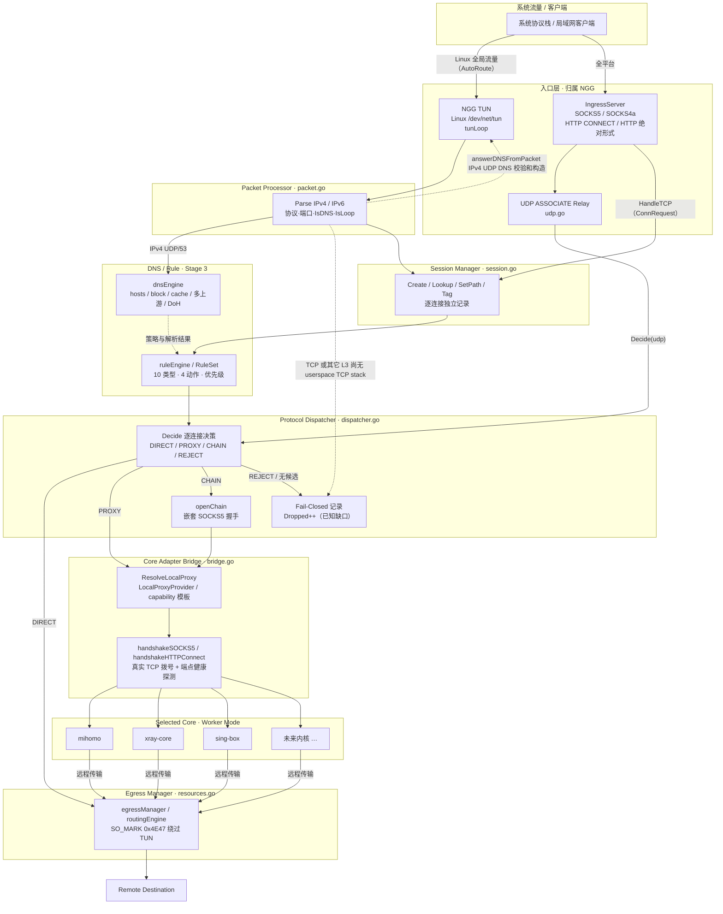

# NGG Stage 2 — 统一网络引擎技术设计

> **适用版本**：Phase 1 + Stage 2~5 当前实现
> **对应源码**：`internal/netengine/`、`internal/core/proxy.go`、`internal/config/config.go`
> **配套文档**：`08-stage3-5-features.md`（Stage 3~5 能力）、`09-stage2-5-api.md`（新增 REST 端点）、`01-architecture.md`（架构约束与 ADR）
> **文档状态**：技术设计 + 真实实现边界说明。本文所有字段名、常量、路径、数值均来自上述源码，**未实现的能力一律显式标注**。

---

## 0. 能力边界速览（阅读前必读）

Stage 2 交付了**统一网络引擎的数据平面**：全平台可用的 userspace 统一入口、Packet Processor、Session Manager、逐连接 Protocol Dispatcher、Core Adapter Bridge、Fail-Closed/Failover 决策、资源隔离与防回环。但必须严格区分下列三类内容：

| 标记 | 含义 |
| --- | --- |
| **【已实现】** | 已落地、经真实 socket 测试验证的能力 |
| **【能力边界】** | 已实现，但只在特定 OS / 特定条件下可用，或只覆盖部分协议面 |
| **【已知缺口 / 未实现】** | 明确尚未实现，不得写成已实现 |

| 项 | 状态 | 说明 |
| --- | --- | --- |
| SOCKS5 / SOCKS4a / HTTP CONNECT / HTTP 绝对形式统一入口 | 【已实现】 | `ingress.go`，全平台可用，真实 socket 测试覆盖 |
| IPv4 / IPv6 包解析、DNS 分类、回环识别 | 【已实现】 | `packet.go`，紧凑可审计解析器，不依赖 gopacket |
| 逐连接会话表、逐连接决策、多核并行、多核链 | 【已实现】 | `session.go` / `dispatcher.go` / `bridge.go` |
| Core Bridge 真实拨号 + SOCKS5 / HTTP CONNECT 握手 | 【已实现】 | 每个端点在移交流量前真实 `net.Dial`，非"假定可达" |
| UDP ASSOCIATE 中继 | 【已实现】 | `udp.go`，RFC 1928 §7，TCP 控制连接决定关联生命周期 |
| Linux 统一 TUN（`/dev/net/tun` + TUNSETIFF + iproute2 + fwmark） | 【能力边界】 | **仅 Linux** 且需 `/dev/net/tun` 与 `CAP_NET_ADMIN`；`AutoRoute` 默认只在 Linux 为真 |
| Windows / macOS 统一 TUN | 【能力边界】 | `tun_other.go` 明确返回 `ErrTUNUnsupported`，**改用全平台可用的 SOCKS5 / HTTP CONNECT 入口** |
| TUN 读环回（真实 L3 解析 + IPv4 DNS 应答包构造 + Fail-Closed 记录） | 【已实现，能力边界】 | `netengine.go:tunLoop` 完成真实 L3 解析、构造带 IP/UDP 校验和的 DNS 应答包并写回 |
| **TUN 内 TCP 流终止（userspace TCP stack）** | **【已知缺口 / 未实现】** | 从裸 L3 终止 TCP 需要 userspace TCP 协议栈；当前此类包被**显式 Fail-Closed 丢弃并计数**（`Dropped++`），**绝不静默直连、绝不谎报已代理** |
| 统一 TUN 全局接管（全平台、全流量） | **【未实现】** | 不得写成"已实现统一 TUN 全局接管" |
| 后量子代理协议集成、iOS/Android 原生客户端 | 【未实现 / 骨架】 | 见 `08-stage3-5-features.md` |

> **测试纪律（约束 10，延续）**：所有模块必须在**真实网络环境**验证，禁止用 mock / 桩 / 硬编码 `success` 冒充验收结果。第 9 节列出的 `netengine_test.go` 8 个测试全部使用真实 TCP/UDP socket、真实 SOCKS5 内核 fixture、真实 echo / HTTP 目标。

---

## 1. 分层架构与流量路径

下图是 Stage 2 的**实际数据流**（不是 Phase 1 的目标草图）。注意 TUN 分支与 userspace 入口分支在 `Session Manager` 之前并不完全等价：TUN 分支目前只完成 L3 解析 + DNS 应答 + Fail-Closed 记录，TCP 流终止仍是已知缺口。



**路径要点**

1. **NGG 是唯一入口、唯一决策者、唯一出口调度者**；内核只做协议执行（约束 1/3/6）。
2. **逐连接独立决策**：`Decide()` 对每条连接单独调用 `rules.Match()`，不同连接可同时被分派到不同内核或 DIRECT，互不串流。
3. **DIRECT 由 NGG 直接处理**（`openDirect`），不经过任何内核。
4. **防 DIRECT 泄漏**：所有内核候选失败时默认 `Fail-Closed` 丢弃；只有 `DirectOnFailure=true` 且 `FailClosed=false` 时才走显式 opt-in 的直连泄漏路径（`dispatcher.go`）。
5. 图中 TUN 分支的虚线 `Fail-Closed 记录` 是**真实行为**，不是示意：当前 `tunLoop` 对非 DNS 的 L3 包只做会话登记 + `Dropped++`。

---

## 2. 逐模块职责表

| 模块 | 源码 | 职责 | 状态 |
| --- | --- | --- | --- |
| `Engine` | `netengine.go` | 统一网络引擎总装配；`Start/Stop` 全量资源回滚；`HandleTCP` 主数据路径；`tunLoop` TUN 读环回；`Status()` 汇总 | 【已实现】 |
| `Config` / `DefaultConfig` | `types.go` | Stage 2~5 网络引擎自身配置（NGG 拥有，内核不得拥有），含 `Network` 段（`config.go`） | 【已实现】 |
| `Metrics` | `types.go` | 数据路径上的真实原子计数器（连接、字节、DNS、规则命中、故障切换、TUN 包数等） | 【已实现】 |
| `TunDevice` (Linux) | `tun_linux.go` | 打开 `/dev/net/tun`、`TUNSETIFF`、设 MTU、配地址、`ip link up`、`AutoRoute` 写路由表与 fwmark 规则 | 【能力边界】仅 Linux + CAP_NET_ADMIN |
| `TunDevice` (其它 OS) | `tun_other.go` | 明确返回 `ErrTUNUnsupported`，不伪装 TUN | 【能力边界】 |
| `IngressServer` | `ingress.go` | 单监听统一入口，按首字节分派 SOCKS5 / SOCKS4a / HTTP；非回环监听强制认证 | 【已实现】 |
| `udpRelay` | `udp.go` | 真实 SOCKS5 UDP ASSOCIATE 中继，逐数据报走 Decide，DIRECT / 内核两种路径 | 【已实现】 |
| `packetProcessor` | `packet.go` | IPv4 / IPv6（含扩展头跳过）解析、TCP/UDP 端口提取、DNS 与回环分类、`Process` 包级硬安全规则 | 【已实现】 |
| `sessionManager` | `session.go` | 会话表（`max=8192`、`ttl=5m`）、状态 `establishing/active/closed/failed`、路径与标签记录 | 【已实现】 |
| `ResourceManager` | `resources.go` | 集中预留 TUN / 端口 / 内核端口、保护端口与保留网段、`AssertNoLoop` 防回环 | 【已实现】 |
| `egressManager` / `routingEngine` | `resources.go` | 出站接口绑定、真实 `net.Dialer`、Linux `SO_MARK` 绕过 TUN；`Select` 取物理出口 | 【已实现，能力边界】SO_MARK 仅 Linux |
| `ruleEngine` / `RuleSet` | `rules.go` | Stage 3 全局规则匹配（详见 `08-stage3-5-features.md`） | 【已实现】 |
| `dnsEngine` | `dns.go` | UDP/TCP DNS 监听、hosts/block、缓存 TTL、多上游、DoH、Resolve | 【已实现】 |
| `protocolDispatcher` | `dispatcher.go` | `Decide` / `Dispatch` / `Open` / `OpenWithDecision`；DIRECT / PROXY / CHAIN / Failover / Fail-Closed | 【已实现】 |
| `CoreBridge` | `bridge.go` | 解析内核本地端点、真实拨号、SOCKS5 / HTTP CONNECT 握手、连接跟踪与统一关闭 | 【已实现】 |
| `StreamAdapterImpl` | `types.go` | 预留 `StreamAdapter` 契约的 Stage 2 实现，报告真实连接统计 | 【已实现】 |
| `SelfTest` / `DialSOCKS5` | `selftest.go` | 真实端到端自检：起本地 echo server → 经 NGG 入口 + 选定内核 → 校验字节逐字回显 | 【已实现】 |
| `ProxyEndpoint` / `ResolveLocalProxy` / `IsHealthyEndpoint` | `core/proxy.go` | 本地端点能力注册与真实健康探测 | 【已实现】 |

---

## 3. 统一 TUN 生命周期与 Linux 能力边界

### 3.1 生命周期（`Engine.Start` → `Engine.Stop`）

`Start()` 按固定顺序集中登记并拉起资源，**任一步失败即全量 `rollback()`**，不给系统留下半配置状态：

1. `resources.ReserveFor("tun", cfg.TUN.Name, "ngg")` — 登记唯一 TUN 名；
2. `ReserveFor("port", Ingress.Port, "ngg-ingress")` — 登记入口端口；
3. `DNS.Enabled` 时登记 DNS 端口；遍历注册表登记每个内核的隔离端口块；
4. `dnsEngine.Start()` — 绑定 UDP + TCP DNS 监听（失败即回滚）；
5. **`cfg.TUN.AutoRoute == true` 时**才尝试 `tun.Open()`；成功则启动 `tunLoop` goroutine（失败不使 Start 失败，TUN 为可选能力）；
6. `ingress.Start()` — 绑定统一入口（失败则关闭 TUN、停 DNS、回滚）；
7. `egress.Bind("ngg-direct", ...)`，并在 `BypassTUN` 时为每个内核调用 `BypassTUN`；
8. 置 `running=true`，发布 `network.network.started` 事件（payload 含 `tun` / `ingress` / `dns` 真实状态）。

`Stop()` 顺序刻意设计为**先关内核上游连接**（`bridge.Close()`），再停入口、DNS、TUN，最后 `rollback()`；这样 relay goroutine 不会被 keep-alive 会话阻塞。

### 3.2 Linux 真实能力（`tun_linux.go`）

| 步骤 | 实现 | 依赖 |
| --- | --- | --- |
| 打开设备 | `os.OpenFile("/dev/net/tun", O_RDWR, 0)` | 内核 `tun` 模块 + 设备节点 |
| 创建接口 | `ioctl(TUNSETIFF=0x400454ca)`，flags `IFF_TUN(0x0001) \| IFF_NO_PI(0x1000)` | `CAP_NET_ADMIN`；失败返回 `ErrTUNUnsupported` 并注明 |
| 设 MTU | `SIOCSIFMTU(0x8922)`，失败回退 `ip link set dev <name> mtu <mtu>` | `golang.org/x/sys/unix` |
| 配地址 | `ip addr add <IPv4/IPv6> dev <name>`、`ip link set <name> up` | **iproute2（`ip` 命令）** |
| 全局路由 | `ip route replace default dev <name> table 17890`、`ip rule add fwmark 0x4E47 lookup 17890` | 仅 `AutoRoute=true` 时；NGG 是唯一写全局路由者 |

**fwmark `0x4E47`（"NG"）绕过 TUN**：`egressManager.Dialer()` 构造真实 `net.Dialer`，并在 `BypassTUN && mark != 0` 时挂 `Control` 钩子，Linux 下由 `egress_linux.go:setSockMark` 调用 `SetsockoptInt(SOL_SOCKET, SO_MARK, mark)`。带该标记的**内核远程传输连接**按 `ip rule` 查 `table 17890` 之外的路由，从而绕过 NGG TUN，避免"内核出站 → 又进 TUN → 再回内核"的死循环。非 Linux（`egress_other.go`）`setSockMark` 为空操作，改用绑定本地地址做出站隔离，该缺失如实反映在 `Status()` 中。

### 3.3 能力边界（必须如实标注）

- **默认 `AutoRoute` 只在 Linux 为真**：`DefaultConfig()` 中 `AutoRoute: runtime.GOOS == "linux"`、`StrictRoute: true`。
- **Windows / macOS 无 TUN**：`tun_other.go` 的 `Open()` 返回 `ErrTUNUnsupported`（`unified TUN requires Linux with /dev/net/tun and CAP_NET_ADMIN`），`Read/Write` 同样返回该错误，**不模拟 TUN**。这些平台改用**全平台可用的 `IngressServer`（SOCKS5 / HTTP CONNECT）**，且该入口已被真实网络测试完整覆盖。
- **TUN 读环回目前做到**：`tunLoop` 从 TUN 读真实 IP 包 → `packetProcessor.Parse()` 得到 `Packet` → IPv4 UDP/53 交给 `answerDNSFromPacket()` 构造**带正确 IP 头校验和与 UDP 伪首部校验和**的真实 DNS 应答包写回 TUN → 计数 `TUNPacketsIn/Out`、`DNSQueries`。
- **TUN 读环回目前没做到（已知缺口，不得写成已实现）**：对 TCP 及其它非 DNS 的 L3 包，仅创建一个 `Session` 记录并立即关闭，然后 `Dropped.Add(1)`。**从裸 L3 终止 TCP 流需要 userspace TCP 协议栈，属于尚未实现的已知缺口**。源码注释明确："never silently leaked and never reported as successfully proxied"。因此：
  - ❌ 不得写"已实现统一 TUN 全局接管 / 全流量代理"；
  - ❌ 不得把 TUN 分支的 TCP 包计入 `Proxied`；
  - ✅ 当前全平台可用于真实代理的是 **userspace 统一入口**（SOCKS5/SOCKS4a/HTTP CONNECT/HTTP 绝对形式），它经 `HandleTCP` 走完整 `Session → Rule → Dispatcher → Bridge → Selected Core` 链路。

---

## 4. 四种入口握手流程（`ingress.go`）

`IngressServer` 只开**一个** TCP 监听（默认 `127.0.0.1:18080`）。`serveConn` 用 `bufio.Reader.Peek(1)` 看首字节后分派；被 peek 的字节通过 `bufferedConn` 保留，不会丢失。非回环监听且未配置 `AuthUser/AuthPass` 时 `Start()` 直接返回 `ErrIngressInsecure`。

| 首字节 | 入口 | 关键流程 |
| --- | --- | --- |
| `0x05` | SOCKS5（RFC 1928） | 方法协商 → 可选用户/口令认证 → CONNECT / UDP ASSOCIATE → `HandleTCP` |
| `0x04` | SOCKS4a | 读 8 字节头 + USERID C-string；`0.0.0.1` 表示后跟域名 → `HandleTCP` |
| 其它 | HTTP | `http.ReadRequest` → CONNECT 或绝对形式 HTTP → `HandleTCP` |

### 4.1 SOCKS5

1. 读 `VER/NMETHODS/METHODS`；若 `AuthUser` 非空则只接受 `0x02`（用户/口令），否则 `0x00`（无认证）；不匹配回 `05 FF`。
2. `0x02` 时读 RFC 1929 认证子协商，`authorized(user, pass)` 校验；失败回 `01 01`。用户名中的 `tenant:xxx` 前缀由 `tenantFromUser()` 提取为 `TenantID`（Stage 5 租户隔离入口）。
3. 读 `VER/CMD/RSV/ATYP`，`readSOCKSAddress()` 支持 `0x01`(IPv4) / `0x04`(IPv6) / `0x03`(域名)，再读 2 字节端口，拼成 `host:port`。
4. `CMD=0x03` → `handleUDPAssociate()`；`CMD≠0x01` → 回 `05 07`（不支持的命令）；`CMD=0x01` → 构造 `ConnRequest{Dst, Domain, Network:"tcp", TenantID, ClientAddr, OnEstablished}` 交给 `Engine.HandleTCP`。
5. `OnEstablished` 回调在真实上游连上后回 `05 00 00 01 00 00 00 00 00 00`；失败回 `05 05 ...`。**握手成功响应发生在真实上游建立之后**，不是提前假装成功。

### 4.2 SOCKS4a

读 `VN/CDSTPORT/DSTIP/USERID`；当 `DSTIP == 0.0.0.1` 时再读一个域名 C-string 作为目标。端口由 `hdr[2]<<8 | hdr[3]` 得到。成功回 `00 5A ...`，失败回 `00 5B ...`。

### 4.3 HTTP CONNECT

`http.ReadRequest` 解析；若配置认证则校验 `Proxy-Authorization: Basic`（失败回 `407` + `Proxy-Authenticate: Basic realm="NGG"`）。`Host` 无端口时补 `:443`；`X-NGG-Tenant` 头作为租户。上游建立后回 `HTTP/1.1 200 Connection Established`，失败回 `502 Bad Gateway`。

### 4.4 HTTP 绝对形式

要求 `req.URL.IsAbs()`（否则 `400`）。把 `RequestURI` 清空、`URL.Scheme/Host` 清空、`Host` 改写为纯主机名，然后用 `req.Write()` 序列化成 `Prefix` 字节，交给 `HandleTCP` 在连上上游后**先写 Prefix 再转发**。这是 `TestHTTPProxyThroughNGG` 用 `net/http` + `httptest` 真实跑通的路径。

### 4.5 UDP ASSOCIATE（`udp.go`）

`net.ListenPacket("udp4", "<listen>:0")` 取随机端口，回 `05 00 ... + BND.ADDR/BND.PORT`；TCP 控制连接的存活期即关联存活期。每个数据报解析 `RSV/FRAG/ATYP/ADDR/PORT/DATA`（`FRAG≠0` 明确丢弃，不假装支持分片），构造 `Session{Network:"udp"}` 走 `dispatcher.Decide()`：DIRECT 直接 `net.DialTimeout("udp", ...)` 收发；否则通过 `association()` 与内核本地端点建立 SOCKS5 UDP ASSOCIATE 控制连接，封装后发往内核 relay 地址再取回答。

---

## 5. Core Bridge 与本地端点能力注册

### 5.1 端点从哪来（`core/proxy.go`）

`ResolveLocalProxy(a CoreAdapter, p RuntimeParams)` 是**唯一**把"已注册内核"映射成"可拨号本地端点"的地方，新内核自动接入，不需要改网络引擎：

1. 内核若实现可选扩展 `LocalProxyProvider.LocalProxy(p) ProxyEndpoint` 且 `Address != ""` → 采用；`Kind` 缺省 `socks5`，`Networks` 缺省 `["tcp"]`。
2. 否则回退能力描述符 `Capability.LocalTCPEndpoint` 模板，用端口占位符渲染：`{{.MixedPort}}` / `{{.SocksPort}}` / `{{.HTTPPort}}` / `{{.APIPort}}` / `{{.DNSPort}}`（也兼容 `{mixed_port}` 等短形式）；`Kind` 取 `LocalProxyKind`，缺省 `socks5`。
3. `ProxyKind` 枚举：`socks5` / `http-connect` / `mixed`（SOCKS5 + HTTP CONNECT 同端口）/ `transparent`。

**健康探测是真实拨号**：`IsHealthyEndpoint()` → `TCPReachable(address, 800ms)` 执行真实 `net.DialTimeout`，不是缓存布尔值。`CoreBridge.Endpoints()` 对每个注册内核输出 `{core_id, kind, address, healthy}`，解析失败时附 `error`。

### 5.2 连接建立（`bridge.go`）

`Connect(ctx, coreID, "tcp", dst)`：

1. `endpoint()` → `registry.Get(coreID)` + `ports.Get(coreID)` → `ResolveLocalProxy`；无隔离资源块则报错。
2. 端点类型必须是 `socks5` / `mixed` / `http-connect`，否则拒绝。
3. `resources.AssertNoLoop(coreID, tcpAddr)` 防回环。
4. 真实 `net.Dialer{Timeout:8s}.DialContext()` 拨内核本地端点；失败计 `KernelErrors++` 并返回"unreachable"。
5. 设 12s 握手 deadline：`http-connect` 走 `handshakeHTTPConnect()`，其余走 `handshakeSOCKS5()`；成功后清除 deadline，连接被 `trackedConn` 跟踪，`Close()` 统一关闭。

`handshakeSOCKS5()` 实现 RFC 1928 无认证 / `0x02` 用户口令子协商 + CONNECT 请求（ATYP 支持 IPv4/IPv6/域名，域名**透传给内核远端解析**，NGG DNS 只用于 DIRECT / 策略）；校验 `REP==0`，并按 ATYP 跳过 BND.ADDR/BND.PORT。`handshakeHTTPConnect()` 发 `CONNECT <dst> HTTP/1.1` + `Host` + 可选 `Proxy-Authorization`，读状态行直到空行，只接受 `200`。

> **能力边界**：`Connect()` 对 `network=="udp"` 明确返回错误——UDP 由 SOCKS5 UDP ASSOCIATE 中继处理，不伪装成 TCP Connect。

---

## 6. 多核链（嵌套 SOCKS5 握手）

`Rule.Chain []CoreID` 或 `RouteDecision.Chain` 触发 `dispatcher.openChain()`，构造**真实多内核代理链**：

```
NGG --TCP--> 内核A本地端点 --SOCKS5 CONNECT(内核B端点)--> 内核B --SOCKS5 CONNECT(dst)--> 目标
```

- 第 0 跳用 `net.Dialer{Timeout:8s}` 真实拨号到 `chain[0]` 的 `ep.Address`；
- 之后每一跳在**上一跳已建立的隧道连接上**再执行一次 `handshakeSOCKS5(conn, next, "", "")`，`next` 是下一跳内核的本地端点地址，最后一跳的 `next` 是真正的 `dst`；
- 每跳 12s 握手 deadline，任一端点解析失败 / 握手失败即关闭已建连接并返回错误；
- `candidates()` 在 `Chain` 非空时整条链作为候选顺序（不再追加 Failover 内核）；`Chain` 长度 ≥2 才走 `openChain`，长度 1 退化为普通 `bridge.Connect`。

`Failover` 顺序在无 Chain 时是**确定性的**：先 `decision.CoreID`，再按注册表描述符顺序追加其它内核；`Failover=false` 时只保留首选内核。第 `i>0` 个候选成功时 `Failovers++`。

---

## 7. 资源隔离与防回环

`ResourceManager` 是 NGG 对 TUN / 端口 / 路由 / 标记 / 接口 / 进程身份的**唯一所有者**（约束 8），内核不得自行抢占。

| 机制 | 实现 |
| --- | --- |
| 集中预留 | `ReserveFor(kind, key, owner)`：`kind ∈ {tun, port, kernel-port}`；同一 key 被不同 owner 二次预留 → `resource conflict: ... already owned by ...` |
| 保护端口 | 预留 `port` 时同步写入 `protected[port]=owner`；`ProtectPort()` 可显式登记 |
| 保留网段 | 构造时硬编码 `169.254.0.0/16`、`10.89.0.0/24`、`fd89::/64`（与 `DefaultConfig` 的 TUN 网段一致） |
| `AssertNoLoop` | 目标端口命中 `protected` → `ErrLoopDetected`；目标 IP 落在保留网段且端口非 0 → `ErrLoopDetected`；否则放行 |
| 包级回环 | `packetProcessor.Parse()` 用 `IsProtectedDestination()` 置 `Packet.IsLoop`；`Process()` 对 `IsLoop` 直接 `ActionDrop + ErrLoopDetected` |
| 连接级回环 | `CoreBridge.Connect()` 与 `dispatcher.OpenWithDecision()` 在打开上游前都调 `AssertNoLoop` |
| 出站绕行 | `egressManager.Dialer()` 的 `SO_MARK`（见 §3.2），`BypassTUN` 为每个内核绑定标记 |
| 冲突查询 | `Conflicts()` / `Snapshot()` 输出 `kind/key=owner`，供 `/network/status` 展示 |

`TestSessionManagerAndResources` 真实断言：重复预留冲突、到自身入口 `127.0.0.1:18080` 回环被拒、到 TUN 子网 `10.89.0.9:443` 被拒、普通公网目标 `93.184.216.34:443` 放行。

---

## 8. Fail-Closed / Failover 决策表

`Config` 关键开关（默认值来自 `DefaultConfig()`）：`FailClosed=true`、`Failover=true`、`DirectOnFailure=false`、`DefaultCore=""`。

| 场景 | 决策 | 结果 | 计数 |
| --- | --- | --- | --- |
| `Decide` 规则动作 `REJECT` / `decision.Block` | 拒绝 | `ErrFailClosed: rule rejected the connection` | `Dropped++` |
| 租户 `Allowed()==false` | 拒绝 | `tenant %q is not allowed` | `Dropped++`（`reject` 路径） |
| `AssertNoLoop` 命中保护端口 / 保留网段 | 丢弃 | `ErrLoopDetected` | `Dropped++` |
| 无内核候选（`candidates()` 为空） | 丢弃 | `ErrFailClosed: no kernel candidate available` | `Dropped++` |
| `decision.Direct=true` | NGG 用 `egress.Dialer()` 真实直连 | DIRECT 路径 | `Direct++` |
| 首选内核拨号/握手失败，`Failover=true` | 按确定性顺序尝试后续内核 | 第 `i>0` 个成功 | `Failovers++`、`Proxied++` |
| 首选内核失败，`Failover=false` | 立即停止尝试 | 全部失败 → `ErrFailClosed` | `KernelErrors++`、`Dropped++` |
| 所有内核失败且 `DirectOnFailure=true && FailClosed=false` | **显式 opt-in 直连泄漏** | 直连成功才返回 | `Direct++` |
| 所有内核失败（默认配置） | **Fail-Closed 丢弃，绝不自动直连** | `ErrFailClosed: <lastErr>` | `KernelErrors++`、`Dropped++` |
| 握手成功但后续 relay 出错 | 关闭上游、会话置 `failed` | 不谎报成功 | `Active--` |
| 会话表满（`max=8192`，先淘汰过期） | 丢弃 | `ErrFailClosed` | — |

> `TestFailClosedWhenKernelDown` 真实验证：内核端点为未监听端口时 `SelfTest` 返回 `ok:false`，且 `Metrics().Direct.Load() == 0`（**无 DIRECT 泄漏**）。

`Config` 之外的错误常量（`types.go`）：`ErrNotRunning`、`ErrAlreadyRunning`、`ErrFailClosed`、`ErrLoopDetected`、`ErrKernelDown`、`ErrTUNUnsupported`、`ErrIngressInsecure`。

---

## 9. 真实测试清单（`netengine_test.go`）

全部 8 个测试基于**真实 socket**：内核 fixture 是真实 TCP SOCKS5 代理，目标是真实 echo / `httptest` 服务器，字节真实穿过 `ingress → session → rule → dispatcher → bridge → kernel endpoint → target`。

| # | 测试 | 验证内容 |
| --- | --- | --- |
| 1 | `TestPacketProcessorIPv4DNS` | 合成 IPv4/UDP/53 包解析为 `IsDNS=true`、`ActionDNS`；`ProtectPort(53)` 后回环目标被丢弃 |
| 2 | `TestPacketProcessorIPv6TCP` | IPv6 + TCP 端口解析（含 data offset）、`ActionForward` |
| 3 | `TestRuleEngineMatchTypes` | `DOMAIN-SUFFIX` / `DOMAIN-KEYWORD` / `IP-CIDR` / `DST-PORT` / `TENANT` / 默认规则命中；非法正则与非法 CIDR 被拒 |
| 4 | `TestSessionManagerAndResources` | 会话表容量/路径记录/关闭；端口重复预留冲突、`AssertNoLoop` 三类断言 |
| 5 | `TestEndToEndThroughRealSockets` | **真实端到端**：`SelfTest(ctx,"mihomo")` 经 NGG 入口 + 真实内核 + echo 逐字回显；`Proxied>0`、`BytesOut>0` |
| 6 | `TestHTTPProxyThroughNGG` | `net/http` 以 NGG 为绝对形式 HTTP 代理访问真实 `httptest`，校验 `200` 与响应体 `NGG-HTTP-OK:/hello` |
| 7 | `TestFailClosedWhenKernelDown` | 内核不可达时 `SelfTest.ok=false` 且 `Direct==0`（防泄漏） |
| 8 | `TestSOCKS5DirectDial` | 导出的 `DialSOCKS5` 对真实 SOCKS5 代理 + 真实 echo 完成大写回显 |

**实测输出**（`go test ./internal/netengine/ -v -count=1`，Windows amd64 / Go 1.27.3 真机）：

```
=== RUN   TestEndToEndThroughRealSockets
    netengine_test.go:306: path=NGG ingress -> mihomo -> echo latency=1.037ms bytes_out=156
--- PASS: TestEndToEndThroughRealSockets (0.01s)
...
PASS
ok  	github.com/ngg-project/ngg/internal/netengine	1.413s
```

即真实链路 **往返延迟约 1.04ms（`latency_ms=1.037`）**、**中继字节 `bytes_out=156`**（自检 payload `"NGG-SELFTEST:" + 64 位 hex nonce + "\n"` 双向中继合计）。`SelfTest` 返回字段：`ok / target / proxy / core_id / bytes / latency_ms / path / echo / sessions`；失败时返回 `ok:false` + `error` + `fail_closed`，**不伪造成功**。

全量 `go test ./... -count=1` 亦通过（`netengine` / `core` / `api` / `engine` / `pq` / `protocols` / `plugins` / `sdwan` / `tenants` / `store` / `mobile` 等包均 `ok`）。

---

## 10. 配置字段速查（`netengine.Config` → `config.Config.Network`）

`DefaultConfig()` 实际默认值：

| 字段 | 默认值 |
| --- | --- |
| `enabled` / `fail_closed` / `failover` | `true` / `true` / `true` |
| `ingress` | `enabled=true, listen=127.0.0.1, port=18080`, `auth_user/auth_pass=""` |
| `tun` | `name=ngg0, mtu=1500, ipv4=10.89.0.1/24, ipv6=fd89::1/64, auto_route=(GOOS==linux), strict_route=true` |
| `dns` | `enabled=true, listen=127.0.0.1, port=18053, upstreams=["223.5.5.5:53","119.29.29.29:53"], cache_ttl=60` |
| `egress` | `bypass_tun=true, mark=0x4E47` |
| `default_core` / `direct_on_failure` | `""` / `false` |

`TUN.AutoRoute` 是 `Start()` 中是否尝试打开 TUN 的唯一开关；`Ingress.Enabled=false` 时统一入口不监听；`DNS.Enabled=false` 时 DNS 监听不启动且端口不预留。

`GET /api/v1/network/status` 输出字段见 `09-stage2-5-api.md`，包含 `running / stage:2 / fail_closed / failover / ingress{enabled,address,protocols:[socks5,socks4a,http-connect,http-absolute]} / tun{configured,active,name,mtu,stats} / dns / rules / sessions / endpoints / healthy / resources / metrics / plugins`。

---

## 11. 相关文档

| 文档 | 内容 |
| --- | --- |
| `01-architecture.md` | 10 条最高级约束、分层架构、全部 ADR、Stage 2~5 实现状态 |
| `08-stage3-5-features.md` | 规则 / DNS / 协议中心 / 后量子 / 插件 / SD-WAN / 多租户 / 跨平台 |
| `09-stage2-5-api.md` | Stage 2~5 全部新增 REST 端点（含请求/响应/错误码/curl） |
| `06-roadmap.md` | 五阶段交付物、验收证据与「真实网络环境验证」纪律 |
| `02-api.md` | Phase 1 的 32 个端点与 Stage 2~5 端点总表 |
