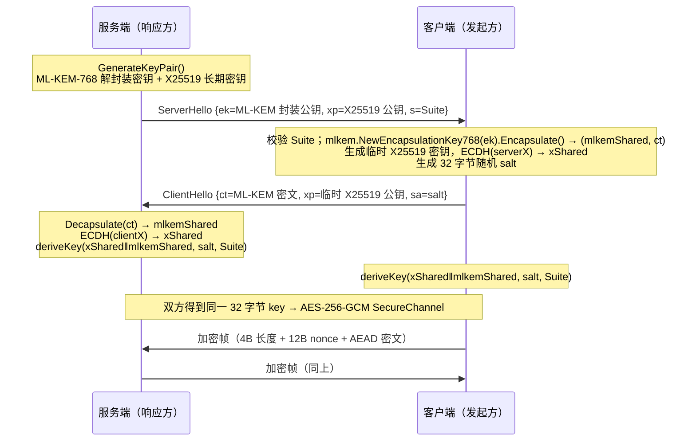

# NGG Stage 3~5 — 特性设计与实现状态

> **适用版本**：Phase 1 + Stage 2~5 当前实现
> **对应源码**：`internal/netengine/{rules,dns,resources}.go`、`internal/protocols/`、`internal/pq/`、`internal/plugins/`、`internal/sdwan/`、`internal/tenants/`、`internal/mobile/`、`internal/api/stage45.go`、`internal/engine/stage45.go`
> **配套文档**：`07-stage2-network-engine.md`（Stage 2 数据平面）、`09-stage2-5-api.md`（端点）、`06-roadmap.md`（验收纪律）
> **文档状态**：每节开头标注 **【已实现】/【骨架】/【能力边界】**。字段名、常量、数值均取自源码；**未实现的内容不写成已实现**。

---

## 0. 状态标注约定

| 标记 | 含义 |
| --- | --- |
| **【已实现】** | 有真实逻辑与真实测试，行为可由源码与 `go test` 复现 |
| **【骨架】** | 结构 / 接口 / 目录已就位，但完整产品形态（如原生 UI 客户端、插件市场）尚未交付 |
| **【能力边界】** | 已实现，但有明确限制（仅 Linux、仅控制信道、仅配置生成不重写协议栈等） |

`/api/v1/stages` 如实回报五个阶段：`stage1=complete`、`stage2/3/4/5=implemented`，其中 `stage2` 的 `note` 明确写着「Linux TUN requires CAP_NET_ADMIN; userspace ingress is fully active on all platforms」。

---

## 1. Stage 3 — 统一规则引擎

**【已实现】** 源码 `internal/netengine/rules.go`。NGG 拥有全局规则，内核自带的规则段保持关闭；所有全局路由决策在 `ruleEngine.Match()` 完成。

### 1.1 10 种规则类型

| `Rule.Type` | 匹配语义（`matchOne`） |
| --- | --- |
| `DOMAIN` | 域名全等（小写） |
| `DOMAIN-SUFFIX` | 等于去掉前导点的值，或以 `.值` 结尾 |
| `DOMAIN-KEYWORD` | 域名包含关键字 |
| `DOMAIN-REGEX` | `regexp.Compile` 正则匹配（`Validate()` 预编译，非法正则拒绝） |
| `IP-CIDR` | 目标 IP 落在 CIDR（`Validate()` 预校验，非法 CIDR 拒绝） |
| `DST-PORT` | 目标端口字符串相等（默认规则用 `"53"`） |
| `NETWORK` | `tcp` / `udp` 不区分大小写相等 |
| `PROCESS-NAME` | 进程名包含关键字（大小写不敏感） |
| `TENANT` | 租户 ID 相等（**租户规则**，见 §8） |
| `MATCH` | 恒真（兜底） |

### 1.2 4 种动作

| `Rule.Action` | 行为 |
| --- | --- |
| `PROXY` | 走 `CoreID` 或 `Chain`（`Validate()` 强制二者至少有一个） |
| `DIRECT` | `d.Direct=true`，`d.Outbound="direct"` |
| `REJECT` | `d.Block=true`，`d.Outbound="reject"` → Fail-Closed 丢弃 |
| `DNS-LOCAL` | `d.DNSPolicy="local"` + `Direct=true`，交给 NGG DNS 引擎 |

### 1.3 优先级、Fail-Closed 全量替换、租户规则

- **优先级**：`RuleSet` 按 `Priority` 降序稳定排序（`sortLocked`），`Match()` 返回第一个 `Enabled` 且命中的规则；`Enabled=false` 跳过；`TenantID` 非空时只对该租户生效。未命中则返回 `ID="DEFAULT"` 的兜底规则（`Action=defaultAction`，缺省 `DIRECT`）。
- **Fail-Closed 全量替换**：`Replace()` 先对**所有**规则 `Validate()` 并查重 ID，全部通过才 `s.rules = append([]Rule(nil), rules...)`；`LoadRuleFile()`（YAML/JSON）同样「全部校验通过才替换」，**不产生半应用策略**。
- **默认规则**：`DefaultRules()` 4 条 —— `10.0.0.0/8`、`192.168.0.0/16`、`127.0.0.0/8` 直连（优先级 90/90/95），`DST-PORT=53` 走 `DNS-LOCAL`（优先级 80）。
- `Rule` 字段：`id / type / value / action / core_id / chain / tenant_id / priority / enabled / comment`。
- **验收证据**：`TestRuleEngineMatchTypes` 覆盖 5 种类型命中、默认兜底、非法正则 / 非法 CIDR 拒绝。

---

## 2. Stage 3 — DNS 引擎

**【已实现】** 源码 `internal/netengine/dns.go`，基于 `github.com/miekg/dns`。内核级 DNS 劫持在 Worker Mode 保持关闭，系统 DNS 策略全部在此收敛。

| 能力 | 实现 |
| --- | --- |
| 监听 | `net.ListenPacket("udp", addr)` + `net.Listen("tcp", addr)` 两个真实监听，`dns.NewServeMux()` 共用 `handle`；默认 `127.0.0.1:18053` |
| hosts | `cfg.Hosts` 经 `dns.Fqdn` 规范化；命中 A/AAAA 直接构造 60s TTL 的 `dns.A`/`dns.AAAA` 应答 |
| block | `cfg.Block` 命中 → `RcodeNameError`（NXDOMAIN） |
| 缓存 | `cache[name/qtype]`，`cacheStore` 取 `min(CacheTTL(缺省30), 各应答 RR 的 TTL)` 作为过期时间；命中计 `DNSCacheHits++` |
| 多上游 | `exchange()` 顺序遍历 `Upstreams`，任一成功即返回；缺省补 `:53`；全失败返回 `RcodeServerFailure` |
| DoH | 上游以 `https://` 开头时走 `exchangeDoH()`：POST `application/dns-message`，限读 64 KiB，非 200 报错 |
| Resolve | `Resolve(ctx, name, qtype)` 先 hosts/block，再真实查询，返回 `[]net.IP`；`dns.Client` 不接 context，用 channel + `select` 强制超时 |
| 运行时策略 | `SetHosts()` / `Reload()` 更新 hosts/block 并清空缓存 |
| 状态 | `Status()`：`enabled / running / listen / port / upstreams / hosts / blocked / cache_entries` |

### 2.1 TUN 内 DNS 应答包构造（**【能力边界】**）

`netengine.go:answerDNSFromPacket()` 为 TUN 读到的 IPv4 UDP/53 查询构造**真实**应答包：解包 `dns.Msg` → 调 `dnsEngine.Resolve` → 组装 A/AAAA 记录 → `resp.Pack()` → 手写 IPv4 头（总长、ID `0x4E47`、TTL 64、proto 17、源/目的 IP 互换、源/目的端口互换）→ 计算 **IP 头校验和** → 用 12 字节伪首部计算 **UDP 校验和**（和为 0 时写 `0xffff`）→ `tun.Write()` 写回，计 `TUNPacketsOut++`、`DNSQueries++`。

> 该路径**仅处理 IPv4 DNS**（`pkt.IsDNS && pkt.Version == 4`）；IPv6 查询、TCP DNS over TUN 与非 DNS 的 L3 包不在其覆盖范围，TCP 流终止仍是 §07 第 3.3 节所述的**已知缺口**。`checksum()` 是 `netengine.go` 中的真实 ones-complement 实现。

### 2.2 出入口策略（**【已实现，能力边界】**）

- `egressManager.Bind(coreID, iface, mark)` 绑定物理出口；`Dialer()` 返回真实 `net.Dialer`（`LocalAddr` 绑定 + 10s 超时）。
- Linux：`Control` 钩子调 `setSockMark()` 设置 `SO_MARK`（缺省 `0x4E47`），配合 `ip rule add fwmark 0x4E47 lookup 17890` 让内核远程传输绕过 NGG TUN。
- 非 Linux：`setSockMark` 为空操作，仅用绑定本地地址隔离出站，**该能力缺失如实反映而非伪造**。
- `routingEngine.Select()` 从 `egressManager.Binding()` 取 `Egress{Interface, Mark, Gateway}`。
- 规则 `DNS-LOCAL`、`DIRECT`、`PROXY`、`CHAIN` 共同构成出入口决策；Fail-Closed / Failover 见 `07-stage2-network-engine.md` §8。

---

## 3. Stage 4 — VPN / 加密代理协议中心

**【已实现；能力边界：不重写内核协议栈】** 源码 `internal/protocols/protocols.go`。

### 3.1 协议目录与能力注册

`Registry` 装载 `builtin()` **16 个协议 Spec**，按 `Category` 分三类：`vpn`（7）、`encrypted-proxy`（8）、`post-quantum`（1，且 `PQCapable=true`、`Enabled=true`）。`Spec` 字段：`id / name / category / transport / default_port / ports / kernels / features / pq_capable / requires_root / description / enabled`。

| 类别 | 协议 ID |
| --- | --- |
| `vpn` | `wireguard`、`openvpn`、`ipsec-ikev2`、`l2tp-ipsec`、`pptp`、`sstp`、`openconnect` |
| `encrypted-proxy` | `shadowsocks`、`vmess`、`vless-reality`、`trojan`、`hysteria2`、`tuic`、`anytls`、`mieru` |
| `post-quantum` | `mlkem-hybrid`（`X25519+ML-KEM-768+HKDF-SHA256+AES-256-GCM`，`kernels=["ngg-native"]`） |

`Register()` 支持运行时新增 Spec（要求 `id` 非空且至少一个 `kernels`）；`SetEnabled()` 切换启用；`List(category)` 按 ID 排序。

### 3.2 真实内核原生配置生成与格式校验

`GenerateConfig(protocolID, kernel, params)` 产出**真实内核原生配置片段**，不是占位符：

| 协议 / 内核 | 输出格式 | 示例内容 |
| --- | --- | --- |
| `wireguard` / `sing-box` | `json` | `type/tag/server/server_port/local_address/private_key/peer_public_key/reserved` |
| `wireguard` / `mihomo` | `yaml` | `proxies: - type: wireguard ...` |
| `wireguard` / `xray-core` | `json` | `protocol=wireguard` + `settings.address/secretKey/peers` |
| `openvpn` / 任意 | `conf` | `client / dev tun / proto udp / remote ...`，并注明由外部 helper 执行 |
| `shadowsocks` 等 8 种 | `yaml` | `proxies: - name/type/server/port/cipher/password` |
| `mlkem-hybrid` / `ngg-native` | `json` | `type=ngg-pq-control` + suite 说明 |

`ValidateConfig(content, format)` 按格式用 `json.Unmarshal` / `yaml.Unmarshal` / 非空检查做**真实解析校验**；未知协议/内核组合返回错误、畸形 JSON 被拒。

> **【能力边界 / 明确声明】**：NGG **不重写、不替换内核协议栈**。协议中心只负责（a）能力目录与元数据、（b）生成可被内核自身 `-test`/`check` 校验的原生配置片段、（c）格式校验。真正的加密、握手、隧道建立仍由各内核（或 `mlkem-hybrid` 的 NGG 原生控制信道）执行。源码第 1~4 行明确："delegates the actual crypto/handshake to the kernels — NGG never reimplements a kernel's protocol stack"。**不得写成「已完成后量子代理协议集成」**。
>
> **验收证据**：`TestProtocolRegistryAndConfigGeneration` 真实验证目录数量 ≥15、VPN ≥5 / PQ ≥1、5 组 `GenerateConfig` 格式与 `ValidateConfig` 通过、未知协议与畸形 JSON 被拒。

---

## 4. Stage 4 — 后量子混合密钥交换与控制信道

**【已实现；能力边界：仅 NGG 节点间控制信道】** 源码 `internal/pq/pq.go`。

### 4.1 组成与常量

`Suite = "NGG-HYBRID-X25519-MLKEM768-HKDFSHA256-AES256GCM"`；`KeySize=32`、`NonceSize=12`、`MaxFrame=1<<20`、`MLKEMCipher=1088`。使用 Go 标准库 **`crypto/mlkem`（ML-KEM-768 / FIPS 203）** + **`crypto/ecdh` X25519** + **`golang.org/x/crypto/hkdf` HKDF-SHA256** + **AES-256-GCM**。混合设计使共享密钥在「任一分量仍安全」时即安全。

### 4.2 混合握手流程

- 握手消息经 `writeMessage/readMessage` 加 4 字节大端长度前缀，`MaxFrame` 上限防超大帧；
- 载荷用固定键序 TLV（键 `ek / xp / s / ct / sa`），不依赖 map 迭代顺序；
- `deriveKey()`：`ikm = xShared || mlkemShared`，`salt = ClientHello.salt`，`info = Suite`，HKDF-SHA256 读出 32 字节；两端推导同一密钥，帧级随机 nonce 保证可复用。

### 4.3 SecureChannel 帧格式

| 偏移 | 长度 | 内容 |
| --- | --- | --- |
| `0..3` | 4 字节 | 大端 `uint32` 帧长 = `NonceSize + len(ciphertext)` |
| `4..15` | 12 字节 | 每帧随机 nonce（`crypto/rand`） |
| `16..` | 变长 | AES-256-GCM `Seal` 密文（含 16 字节 tag） |

`Read()` 校验 `n > NonceSize && n <= MaxFrame`，`aead.Open` 认证失败返回 `secure channel authentication failed`。`SecureChannel` 实现完整 `net.Conn` 接口。

> **【能力边界 / 必须如实标注】**：该实现是 **NGG 原生控制信道**（`mlkem-hybrid` 的 `kernels=["ngg-native"]`），用途是 **NGG 节点间控制信道**；`GET /api/v1/pq/status` 的 `note` 明确写着「用于 NGG 节点间控制信道；内核数据面协议仍由各内核自行实现」。它**没有**集成进代理数据面协议，**没有**替换任何内核的 TLS/加密栈，`mlkem-hybrid` 在 `GenerateConfig` 里只生成一份 `type=ngg-pq-control` 的 JSON 说明。**不得写成「已完成后量子代理协议集成」**。
>
> **验收证据**：`TestHybridHandshakeSelfTest`（`SelfTest()` 用 `net.Pipe()` 真实握手 + 加密往返，返回 `ok/suite/mlkem/classical/kem/aead/encapsulation_key_bytes/ciphertext_bytes/key_bytes`）、`TestSecureChannelTamperDetection`；`POST /api/v1/pq/selftest` 暴露同一真实自检。

---

## 5. Stage 4 — 插件运行时

**【已实现；骨架：插件市场 / 目录分发】** 源码 `internal/plugins/plugins.go`，`goja`（JS）+ `wazero`（WASM）+ `wasi_snapshot_preview1`。

### 5.1 Manifest 与生命周期

`Manifest` 字段：`id / name / kind / source / hooks / permissions / enabled / description`；`Kind ∈ {javascript, wasm}`；`Hooks ∈ {session, dns}`（缺省 `["session"]`）；`Permissions ∈ {decision:write, log}`（声明式，见下）。

`Install()` 编译成功后 `Loaded=true`；编译失败仍存入管理器但 `Loaded=false` 且记录 `Error`，**不隐瞒失败**。`Enable/Remove/List/Count`、`LoadManifestDir()`（扫描 `*.yaml|yml|json`）构成生命周期。`plugins.d` 目录在启动时由 `engine.initStage45()` 装载。

### 5.2 JS / WASM ABI 与权限沙箱

| 运行时 | ABI | 可写决策 |
| --- | --- | --- |
| `javascript`（goja） | 每次 hook 新建 VM；注入 `ngg.input`（`hook / domain / network / tenant / dst / core_id / direct / block / rule` 或 `name`）、`ngg.log`；脚本须设置全局 `result` 对象，运行时 `json.Marshal` 导出为 `map[string]any` | `core_id`、`direct`、`block`、`tags` |
| `wasm`（wazero） | 校验 `\x00asm` 魔数（支持 base64 `AGFzbQ...` 与文件路径），实例化 WASI，必须导出 `ngg_hook() -> i32`；返回 `1` → `block=true`，`0`/其它 → 放行 | 仅 `block` |

**沙箱（`runJS`）**：`require` 置为 `undefined`，`console.log` / `ngg.log` 为空函数，**不注入文件系统、网络、进程能力**。JS 只能读 `ngg.input` 并写 `result`。WASM 走 wazero 的内存隔离 + WASI 实例化。

`RunSessionHooks()` 依次执行所有 enabled 且含 `session` hook 的插件，合并输出；`RunDNSHooks()` 处理 `dns` hook。**插件报错向上传播并由调用方 Fail-Closed**，坏插件不会静默改策略。`engine/stage45.go:pluginHookAdapter` 把输出映射回 `RouteDecision`（`core_id` 改写内核、`direct`、`block`、`tags`），并接 `OnDNS` 实现域名阻断。

> **【骨架】**：`permissions` 字段为声明式元数据，当前未实现按权限逐项裁剪注入能力的细粒度策略；插件市场 / 远程分发未交付，仅支持本地 `plugins.d` 目录与 REST 安装。
>
> **验收证据**：`TestJavaScriptPluginChangesDecision`（JS 改 `core_id` 与 `tags`、DNS hook 阻断）、`TestRealWASMPlugin`（真实 `testdata/ngg_hook.wasm` 由 wazero 调用）、`TestBrokenPluginIsReported`（非法 JS 如实报错）。

---

## 6. Stage 5 — SD-WAN

**【已实现】** 源码 `internal/sdwan/sdwan.go`，实现 `netengine.LinkSelector`。

| 能力 | 实现 |
| --- | --- |
| 真实链路探测 | `probe()` 对 `ProbeTarget` 执行真实 `net.DialTimeout("tcp", ..., 1500ms)` 并计时；**不是缓存布尔值** |
| EWMA | RTT：`RTTMs = RTTMs*0.7 + rtt*0.3`；丢包：失败 `LossPct*0.7+30`，成功 `LossPct*0.7`；`Healthy = LossPct < 50` |
| 数据面反馈 | `ReportResult(linkID, rttMs, ok)` 用 `0.8/0.2` 权重把真实连接结果回灌 |
| 4 种选路策略 | `lowest-latency`（默认，按 RTT 升序）、`weighted`（按 `Weight` 降序）、`priority`（按 `Priority` 降序）、`failover`（保持 `active`，否则按 `Cost` 升序） |
| 故障切换 | `SelectLink` 只在 `Enabled && Healthy` 中选；无健康链路返回 `no healthy WAN link available (fail-closed)`；`ForceFailover()` 把当前 active 置 `Healthy=false, LossPct=100` 后立即重选；切换计 `switches++` |
| 定时探测 | `Start(ctx)` 先对全部链路探一次，再按 `interval`（默认 3s）ticker 探测并 `SelectLink` |
| 状态 | `Status()`：`policy / active / running / switches / interval_ms / links` |

`Link` 字段：`id / name / interface / gateway / probe_target / weight / cost / priority / enabled / healthy / rtt_ms / loss_pct / probes / failures`。

> **【能力边界】**：`egressManager` 虽持有 `LinkSelector`（`SetLinkSelector`），但 `Dialer()` 中目前只是 `_ = sel` 占位，注释说明「Stage 5 link selection is consulted by RoutingEngine」；即探测/选路/切换逻辑与状态是真实的，但**尚未把选中的物理链路直接注入每个连接的出站拨号**。不得写成「已完成全流量多 WAN 调度」。
>
> **验收证据**：`TestRealLinkProbingAndFailover` 用两个真实 TCP 监听做 probe target，关闭其一后经真实失败拨号触发故障切换，断言 `switches>0` 且每条链路 `Probes>0`。

---

## 7. Stage 5 — 多租户

**【已实现】** 源码 `internal/tenants/tenants.go`，实现 `netengine.TenantResolver`。

`Tenant` 字段：`id / name / enabled / max_sessions / quota_bytes / used_bytes / allowed_cores / allowed_protocols / default_core / rule_set_tag`。

| 能力 | 实现 |
| --- | --- |
| 默认租户 | `NewRegistry()` 内置 `default`（`MaxSessions=100000`、`QuotaBytes=0`），`Remove("default")` 被拒绝 |
| 租户解析 | `ResolveTenant(key)`：空 → `default`；不存在或 `Enabled=false` → 报错 |
| 入口打标 | SOCKS5 用户名 `tenant:xxx`、HTTP `X-NGG-Tenant` 头 → `ConnRequest.TenantID` |
| 数据面隔离 | `Allowed(tenantID, decision)`：配额用尽（`QuotaBytes>0 && UsedBytes>=QuotaBytes`）→ 拒绝；`AllowedCores` 非空时 `decision.CoreID` 必须命中，否则拒绝；`Direct` 或空 `CoreID` 放行 |
| 配额计费 | `Charge(tenantID, bytes)` 累加 `UsedBytes` |
| 规则隔离 | `Rule.TenantID` 使规则只对该租户生效（§1.3） |

> **【能力边界】**：`MaxSessions`（缺省 1000）、`AllowedProtocols`、`DefaultCore`、`RuleSetTag` 目前是**声明式字段**，尚未在数据面逐项强制；`Charge()` 已实现但 `HandleTCP` 主路径当前未把每条连接的字节数回灌到租户计费（会话级 `BytesIn/BytesOut` 由 `SessionRec` 记录）。不得写成「已完成完整企业级配额闭环」。
>
> **验收证据**：`TestTenantIsolation` 真实验证默认租户、允许/禁止内核、DIRECT 放行、配额用尽后拒绝、default 受保护、删除后不可解析。

---

## 8. Stage 5 — 跨平台构建矩阵与 gomobile 共享核心

**【已实现：构建矩阵 + 共享核心】【骨架：原生 UI 客户端】** 源码 `internal/api/stage45.go`、`internal/mobile/mobile.go`。

### 8.1 构建矩阵（真实交叉编译）

`GET /api/v1/platforms` 返回 `host / go / targets / clients / note`，其中 `buildTargets` 为 **12 个** `GOOS/GOARCH`：`linux/{amd64,arm64,386,arm,mipsle}`、`windows/{amd64,arm64}`、`darwin/{amd64,arm64}`、`freebsd/amd64`、`android/arm64`、`ios/arm64`。`clients` 列出 `Android / iOS / iPadOS / HarmonyOS / Windows / macOS / Linux / Android TV / OpenWrt / 软路由`。

`POST /api/v1/platforms/build` 执行**真实 `go build`**：对每个目标设 `GOOS/GOARCH/CGO_ENABLED=0`，`-trimpath -ldflags="-s -w"`，输出到 `bin/platforms/nggd-<goos>-<goarch>[.exe]`，单目标 4 分钟超时，返回 `{ok, results:[{target, ok, output, path}]}`，失败时 `output` 为截断到 400 字符的真实编译输出。未指定 `targets` 时默认编译 4 个：`linux/amd64, linux/arm64, windows/amd64, darwin/arm64`。

### 8.2 gomobile 共享核心

`internal/mobile/mobile.go` 是面向 Android / iOS / iPadOS / HarmonyOS 的**共享 Go 核心**，`Version = "NGG-Stage5-mobile-core/1.0"`。`Gateway` 仅用 `string / error / bool` 参数，gomobile-bind 友好，是真实 REST 客户端（`Authorization: Bearer`）而非模拟桩：

- 查询：`SystemInfo / Cores / NetworkStatus / Stages / SDWANStatus / Protocols`；
- 动作：`StartCore / StopCore / StartNetwork / StopNetwork / BatchStart(idsJSON, exclusive) / SelfTest(coreID) / SetRules(rulesJSON)`；
- 辅助：`ProxyURL()` 从 `network/status` 解析入口地址、`Connectable()` 真实请求 `GET /health` 判断可达（**no simulated connectivity**）。

> **【骨架 / 能力边界 / 必须如实标注】**：`GET /platforms` 的 `note` 明确写着「纯 Go 核心 + gomobile 绑定；**原生 UI 客户端为骨架，需各平台 SDK 打包**」。当前交付的是共享核心与真实交叉编译能力，**没有** iOS / Android 原生 App 安装包、**没有** platform VPN 配置下发、**没有**各平台 SDK 打包产物。不得写成「已完成 iOS/Android 原生客户端」。
>
> **验收证据**：`internal/mobile` 包在 `go test ./... -count=1` 中通过；构建矩阵由 `POST /platforms/build` 真实 `go build` 验证（结果逐目标返回 `ok/output/path`，失败不伪装成功）。

---

## 9. 验收证据汇总（真实运行，非模拟）

| 包 | 测试 | 性质 |
| --- | --- | --- |
| `netengine` | 8 个（见 `07-stage2-network-engine.md` §9） | 真实 socket / echo / SOCKS5 内核 / HTTP 代理；实测 `latency=1.037ms`、`bytes_out=156` |
| `protocols` | `TestProtocolRegistryAndConfigGeneration` | 真实 JSON/YAML/conf 解析校验 |
| `pq` | `TestHybridHandshakeSelfTest`、`TestSecureChannelTamperDetection` | `net.Pipe()` 上真实 ML-KEM-768 + X25519 握手与 AEAD 往返 |
| `plugins` | `TestJavaScriptPluginChangesDecision`、`TestRealWASMPlugin`、`TestBrokenPluginIsReported` | 真实 goja / wazero + 真实 `.wasm` 模块 |
| `sdwan` | `TestRealLinkProbingAndFailover` | 真实 TCP 探测 + 真实断链切换 |
| `tenants` | `TestTenantIsolation` | 真实配额 / 内核白名单 / 删除保护 |
| `mobile` | 包内测试 | 真实 REST 客户端契约 |

`go test ./... -count=1`（Go 1.27.3 / Windows amd64 真机）全绿：`api / core / engine / netengine / mobile / plugins / pq / protocols / sdwan / store / tenants` 等包均 `ok`。

> **纪律声明（延续 `06-roadmap.md` 约束 10）**：以上"已实现"均以真实运行结果为准，禁止用 mock 的 `success`、硬编码状态灯、假进程 / 假版本号冒充验收通过；上表明确列出的【骨架】与【能力边界】项**不计入已完成**。

---

## 10. 相关文档

| 文档 | 内容 |
| --- | --- |
| `07-stage2-network-engine.md` | Stage 2 数据平面、TUN 能力边界、四种入口、多核链、Fail-Closed 决策表 |
| `09-stage2-5-api.md` | Stage 2~5 全部新增 REST 端点与 curl 示例 |
| `01-architecture.md` | 最高级约束、分层架构、全部 ADR |
| `06-roadmap.md` | 五阶段交付物、验收证据、真实网络环境验证纪律 |
| `02-api.md` | Phase 1 的 32 个端点 + Stage 2~5 端点总表 |
